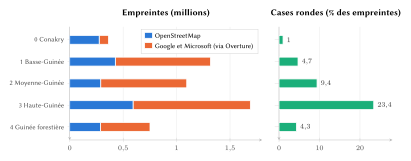
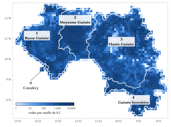
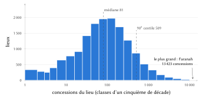
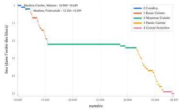
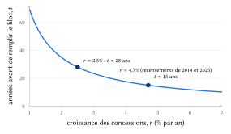
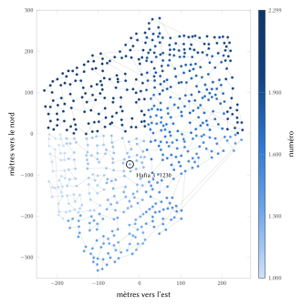
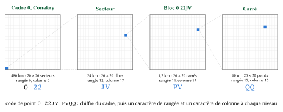

# Introduction

## Le problème

Une adresse remplit trois fonctions. Elle permet à une personne de dire où elle habite, à une autre de trouver l'endroit, et à une institution de tenir un registre qui renvoie à ce lieu et à aucun autre. Aucun système guinéen ne remplit ces trois fonctions pour les logements. L'opérateur postal achemine le courrier vers des boîtes postales précédées d'un radical de trois chiffres qui désigne un bureau distributeur, non un lieu [@upu2005gin]. Un programme national a nommé et signalisé les rues de Kaloum, la commune centrale de la capitale, en 2024, sans numéroter les portes [@africaguinee2024]. Ailleurs, un livreur, une équipe d'ambulance ou un parent en visite trouve une maison au téléphone, de repère en repère.

Le pays change en outre rapidement. Les résultats préliminaires du quatrième Recensement général de la population et de l'habitation (RGPH-4) font état de 17 521 167 habitants en 2025, contre 10 523 261 en 2014 [@bangoura2026; @citypopulation2026]. Conakry est passée de cinq à treize communes en 2024 [@guineenews2024loi; @guineenews2024communes], et les décrets d'août 2026 ont porté le nombre de régions de huit à dix et celui des préfectures de trente-trois à quarante-quatre [@focusguinee2026]. Un système d'adresses intégrant une unité administrative aurait déjà dû être corrigé deux fois.

## Contribution

Cet article décrit un modèle d'adressage conçu pour la Guinée et appliqué à toutes les concessions du pays. Ses apports sont les suivants :

1. un code que l'on peut dire et retenir (un nom de lieu d'usage courant et un numéro lu par paires), et qui reste néanmoins unique à l'échelle nationale sans commune ni préfecture, grâce à une plage nationale de numéros par nom, partagée en blocs figés (section 4.7) ;
2. une numérotation le long d'une courbe de Hilbert, qui donne des numéros proches à des voisins et réserve la place des maisons futures sans renumérotation (sections 4.8 et 4.9) ;
3. des cadres calqués sur les régions postales plutôt que sur les unités administratives, de sorte qu'aucune réforme ne modifie un code (section 4.3) ;
4. une méthode de regroupement des empreintes de bâtiments en concessions, adaptée à l'habitat guinéen, de la parcelle murée de Conakry à la concession de cases rondes de la savane (section 4.13) ;
5. un moteur de référence ouvert, un registre des 3 808 784 codes et un serveur déployable qui reproduit à l'identique les décisions de l'émetteur (section 5) ;
6. une évaluation chiffrée et une estimation des bénéfices pour quatre groupes d'usagers (sections 6 et 8 à 11).

## Plan de l'article

La section 2 passe en revue les systèmes postaux, d'adressage et fonciers de la Guinée ainsi que la littérature internationale. La section 3 décrit les données, la section 4 définit le modèle avec ses formules et des exemples chiffrés, la section 5 présente sa mise en œuvre et la section 6 les propriétés mesurées. La section 7 expose les solutions envisagées puis écartées. Les sections 8 à 11 estiment les bénéfices pour les citoyens, la logistique, les services de secours et l'administration. La section 12 traite de la vie privée et de la gouvernance, la section 13 des limites, et la section 14 conclut.

# Contexte et travaux connexes

## La Guinée : population, habitat et langues

La Guinée couvre 245 857 km² entre l'Atlantique et les sources du Niger [@citypopulation2026]. Selon le RGPH-4, 38,7 % de la population est urbaine et 43 % a moins de quinze ans [@bangoura2026]. Conakry, dans ses nouvelles limites de treize communes, compte 3 407 327 habitants, soit environ un Guinéen sur cinq ; ses communes les plus peuplées sont Gbessia (520 284), Kagbélen (395 370) et Lambanyi (385 884) [@citypopulation2026]. Les deux recensements impliquent une croissance moyenne d'environ 4,7 % par an entre 2014 et 2025, supérieure à la plupart des projections antérieures ; parce que les chiffres de 2025 sont encore préliminaires, nous retenons aussi, plus loin, un taux plus faible de 2,5 %.

Quatre régions naturelles structurent la géographie quotidienne : la Guinée maritime (Basse-Guinée), les hauts plateaux du Fouta-Djalon en Moyenne-Guinée, la savane de Haute-Guinée et la Guinée forestière. La Constitution du 26 septembre 2025 fait des langues nationales des langues officielles aux côtés du français, qui demeure langue de travail [@constitution2025]. Le pular, le maninka et le soussou sont les plus parlées, avec le kissi, le kpelle (guerzé) et le toma (loma) en région forestière. Une part importante des adultes lit difficilement le français, mais presque tout le monde manie les numéros de téléphone, que l'on lit en Guinée par paires de chiffres.

## Les radicaux postaux

La fiche d'adressage de l'Union postale universelle pour la Guinée définit le code postal comme trois chiffres suivis d'un numéro de boîte postale, placés à gauche du nom de la localité, par exemple `001 BP 457 CONAKRY` [@upu2005gin]. Les trois chiffres forment le *radical*, qui achemine l'envoi vers un bureau distributeur ; le numéro de boîte, ou *suffixe*, en assure la distribution. Le premier chiffre est la région postale : 0 Conakry, 1 Basse-Guinée, 2 Moyenne-Guinée, 3 Haute-Guinée et 4 Guinée forestière. Le radical désigne un bureau et non un lieu : deux ménages qui louent une boîte au même bureau le partagent, aussi éloignés qu'ils soient. Le site de l'opérateur propose boîtes, colis et courrier express sans employer l'expression *code postal* [@laposte2026], et l'appel d'offres de 2025 du régulateur pour des États généraux du secteur postal ne mentionne pas l'adressage [@arpt2025].

## L'adressage des rues de Conakry, 1993–2024

La Guinée fut l'un des premiers pays d'Afrique de l'Ouest à adresser sa capitale. Avec l'appui de la Banque mondiale, dans le cadre du deuxième projet de développement urbain lancé en 1993, une cellule municipale d'adressage a cartographié les cinq communes de Conakry, codé chaque rue par les initiales de sa commune et un numéro (`KA.23` désigne la vingt-troisième rue de Kaloum), numéroté les portes selon le système métrique et publié un plan d'adressage et un répertoire des rues [@farvacque2005, p. 65–69]. Le bilan de ce travail retient deux applications durables. L'adressage a servi à délimiter les zones et les circuits d'un service de collecte des ordures confié à de petites entreprises, après quoi le taux de collecte est passé de 20 % à 80 % ; il a aussi guidé l'ouverture de voies secondaires vers des quartiers que les services techniques ne parvenaient pas jusque-là à localiser [@farvacque2005, p. 68–69]. Le même bilan note qu'avant l'adressage, moins de 40 % des avis d'imposition émis à Conakry étaient recouvrés [@farvacque2005, p. 65].

Les codes de rue de cette époque subsistent sur la carte actuelle (OpenStreetMap porte des noms tels que *Rue KA. 040*), mais non les numéros de porte : dans tout le pays, seuls 457 objets cartographiés portent un numéro. En octobre 2024, le ministre de l'Urbanisme et de l'Habitat a présenté un nouveau programme présidentiel d'adressage : les avenues de Kaloum avaient été nommées et signalisées, et devaient suivre Dixinn et Matam, le reste de Conakry, Coyah, Dubréka puis les chefs-lieux de région, avec une application de géolocalisation utilisable hors ligne [@africaguinee2024]. En octobre 2026, nous n'avons trouvé trace ni d'une numérotation des portes ni d'une extension au-delà de Kaloum.

## Des limites administratives en mouvement

La loi votée le 18 janvier 2024 a créé dix-sept communes [@guineenews2024loi] ; Ratoma a été divisée en Ratoma, Lambanyi et Sonfonia, et Matoto en Matoto, Gbessia et Tombolia [@guineenews2024communes]. Les élections communales du 31 mai 2026 se sont tenues dans treize communes de Conakry [@guineenews2026elections]. Les décrets d'août 2026 ont créé les régions de Beyla et de Siguiri et porté le nombre de préfectures à quarante-quatre [@focusguinee2026]. La norme ISO 3166-2 ne répertorie pas encore ces nouvelles unités. Tout code comportant une commune, une préfecture ou une région aurait changé deux fois en trois ans.

## Foncier, recensement et données personnelles

Le RGPH-4 est l'ensemble de données officiel le plus proche d'un registre des logements, mais ses cartes de dénombrement ne sont pas publiques. Le Code foncier et domanial [@ordonnance1992] inscrit les terrains titrés au livre foncier ; l'essentiel des terres relève de la coutume ou d'un permis d'habiter. Les plans cadastraux utilisent le système Dabola 1981 en projection UTM, fuseau 28N [@epsg3461]. Les données personnelles relèvent de la loi L/2016/037/AN, qui impose une déclaration préalable des traitements et une autorisation pour les transferts à l'étranger [@loi2016] ; un décret d'avril 2025 fixe les conditions de sécurité des données d'état civil et d'identification [@decret2025].

## Pratiques internationales de l'adressage

L'étude de la Banque mondiale consacrée à l'adressage dans quinze pays africains, dont la Guinée, établit un coût moyen de 5,7 dollars par porte adressée et de 0,6 dollar par habitant, aux prix de 2005, sur vingt et une villes ayant mené leur programme à terme [@farvacque2005, p. 49]. Sa leçon principale est qu'un adressage inutilisé se dégrade, et que sa valeur tient aux services qui s'appuient sur lui : rôles fiscaux, réseaux, collecte des déchets, planification. L'Union postale universelle présente l'adressage comme une infrastructure publique et documente des programmes nationaux sur plusieurs continents [@upu2012]. Sa norme S42 définit les éléments d'une adresse postale et les modèles selon lesquels chaque pays les compose [@upus42], et la norme ISO 19160-1 propose un modèle conceptuel de l'information d'adresse, alias et cycle de vie compris [@iso19160]. Ces deux normes décrivent la structure et l'échange des adresses ; aucune ne dit comment un pays sans adresses doit les créer. Le modèle présenté ici se décrit dans leurs termes : un nom de lieu et un numéro comme localisant, la rue officielle comme alias lorsqu'elle existe, et un statut qui retrace le cycle de vie de chaque adresse.

## Codes de grille et adresses numériques nationales

Une seconde famille de systèmes dérive un code des coordonnées. L'Open Location Code (Plus Codes) encode latitude et longitude dans un alphabet de vingt symboles et fonctionne partout, hors ligne, selon un algorithme ouvert [@olc]. Le Ghana a adopté en 2017 une adresse numérique nationale calculée sur une grille de carrés de 5 m [@bokpe2018]. Ces codes sont précis et se passent de registre, mais ils désignent un carré plutôt qu'un foyer, comportent des lettres qu'il faut épeler et ne disent rien à ceux qui habitent le lieu. En français, au téléphone, on confond aisément les noms des lettres G et J, M et N, ou B, D, P, T et V. Le modèle conserve donc un code de grille, le code de point de la section 4.12, pour les lieux sans habitation et pour les machines, sans demander à quiconque de le retenir.

## La primauté des adresses officielles

Une règle gouverne la relation du modèle avec le travail de l'État : là où une adresse officielle existe, elle est utilisée et affichée en premier, telle que l'État l'écrit. À Kaloum, toute concession située à moins de 30 m d'une rue nommée affiche d'abord cette rue (« Avenue Dinah Salifou, Kaloum »), le code figurant à côté pour distinguer les portes ; c'est le cas de 3 085 des 5 646 concessions de la commune. Lorsque le programme national numérotera les portes ou atteindra d'autres communes, ces adresses passeront en premier et les codes deviendront des renvois ; aucun code émis ne changera. Une boîte postale est une boîte aux lettres, jamais une adresse ; seul le premier chiffre de son radical survit dans le modèle, comme numéro de cadre.

# Données et sources

## Empreintes de bâtiments

Le modèle utilise les 5 218 074 empreintes de bâtiments situées dans la frontière nationale de la Guinée ou à moins de 300 m de celle-ci (section 3.3) : 1 873 398 issues d'OpenStreetMap [@geofabrik2026] et 3 344 676 issues des détections automatiques de Google Open Buildings [@sirko2021; @openbuildings] et de Microsoft [@microsoft2023], diffusées par le thème « bâtiments » d'Overture Maps [@overture2026], lorsqu'elles ne doublent pas une empreinte d'OpenStreetMap. La figure 1 donne la part de chaque source par cadre. OpenStreetMap domine à Conakry, où les contributeurs ont tracé la plupart des bâtiments ; ailleurs, les détections automatiques fournissent l'essentiel de la carte.

{width=100%}

La moitié des empreintes mesure moins de 44 m² ; la médiane est de 25,0 m² en Haute-Guinée contre 68,8 m² à Conakry, écart qui traduit l'opposition entre les cases rondes de la savane et les maisons rectangulaires en dur de la capitale. Les empreintes détectées portent un attribut de hauteur, mais ses valeurs sont en Guinée une valeur de remplissage : trente-six valeurs réparties régulièrement entre 3,5 et 7,0 m, chacune portée par environ 98 000 empreintes. Nous ne l'utilisons donc pas, et le nombre de niveaux n'est connu que pour les 334 bâtiments pour lesquels OpenStreetMap l'indique.

## Lieux et quartiers

OpenStreetMap contient les contours de 397 quartiers officiels au niveau administratif 10, dont 128 dans le cadre de Conakry et d'autres à Nzérékoré, Coyah, Kankan et ailleurs. Hors de ces contours, les lieux sont nommés d'après les nœuds de lieux d'OpenStreetMap (villes, villages, hameaux, quartiers) et les lieux habités de GeoNames [@geonames2026] absents d'OpenStreetMap, soit au total 16 649 localités situées à moins de 1,1 km d'un cadre guinéen. Les noms des communes et préfectures proviennent des limites administratives du même extrait.

## La frontière nationale

L'étendue du pays est celle de la frontière nationale de la Guinée dans OpenStreetMap (niveau administratif 2, relation 192778), non celle d'un contour de zone. Les contours des cadres de la section 4.3, comme ceux d'autres sources telles que geoBoundaries et GADM, ne suivent la frontière qu'approximativement et la franchissent par endroits. La règle est donc que la frontière décide : un bâtiment dont le centre, ou une concession dont l'entrée, se trouve à plus de 300 m au-delà de la frontière nationale est dans un pays voisin et ne reçoit aucun code, quoi qu'en dise un contour. La marge de 300 m absorbe l'erreur de tracé de la ligne et une concession qui la chevauche. La construction du registre écarte ces bâtiments avant d'attribuer lieu ou numéro, et l'émetteur comme le serveur du registre refusent d'y émettre un code ou d'y déplacer une entrée. Le moteur embarque la frontière simplifiée par Douglas–Peucker à 5 m, un fichier de 0,6 Mo dont l'écart maximal à la ligne réelle, mesuré dans les deux sens, vaut $\delta = 5{,}5$ m ; il accepte un point situé à moins de $300 - \lceil \delta \rceil = 294$ m de la ligne simplifiée, de sorte qu'aucun point situé à plus de 300 m au-delà de la frontière réelle n'est jamais accepté.

## Enclos, sites et rues

Les murs, clôtures et haies cartographiés comme anneaux fermés, les cours de ferme et les petites parcelles résidentielles désignent directement des concessions là où ils existent. Les écoles, hôpitaux, mosquées, marchés, postes de police et sites industriels cartographiés comme surfaces définissent des sites. Les rues nommées de Kaloum fournissent les adresses officielles. Toutes ces données proviennent de l'extrait OpenStreetMap du 17 octobre 2026.

## Reproductibilité

Le registre publié, la table des lieux et les fichiers du modèle suffisent à reproduire chaque figure et chaque tableau du présent article. Les scripts qui ont préparé les données, regroupé les concessions et calculé les statistiques se trouvent dans le répertoire `tools/` du dépôt, et `tools/paper-figures.py` calcule les données de chaque figure à partir des seuls fichiers publiés [@nwaysgn2026].

# Le modèle

## Exigences

Le modèle répond à dix exigences, par ordre de priorité :

1. **Mémorisable et sans effort.** Un code est un nom de lieu déjà en usage et un numéro lu par paires ; l'obtenir demande un seul geste.
2. **Unique à lui seul.** Le code retenu désigne un seul foyer dans tout le pays, sans commune, préfecture ni région.
3. **La concession, jusqu'à son portail.** L'unité adressée est la concession ou la parcelle murée, non un toit isolé ; les bâtiments en sont des sous-unités ; la navigation s'arrête au portail.
4. **L'officiel d'abord.** Là où l'État a une adresse, elle prime.
5. **Aucune limite administrative dans un code.** Les réformes changent les libellés, jamais les codes.
6. **Hors ligne.** Codes de point, codes de bloc et clés de contrôle se calculent sans réseau.
7. **Stable.** Un code ne se déplace jamais et n'est jamais réattribué.
8. **Des lieux, pas des personnes.** Aucun nom ni détail personnel d'habitant n'est conservé.
9. **Ouvert et transférable.** Le moteur, le registre et les règles sont publiés sous licences ouvertes et peuvent être transférés à l'État.
10. **Propre à la Guinée.** Chaque règle est choisie en fonction de l'habitat, des langues et des institutions guinéennes.

## Les formes d'un code

Chaque concession possède un code unique, qui s'écrit sous plusieurs formes (tableau 1).

| Forme | Exemple | Usage |
|:-----|:---------|:-----------|
| Retenue | Hafia 3 · 1230 ; Linsan 5389 | les personnes : dite, saisie, écrite sur un colis |
| Plaque | HAFIA 3 · 1230 | plaques de portail, autocollants, formulaires |
| Machine | GN-04261-1230-8 | applications, codes QR, systèmes partenaires |
| Bâtiment | Hafia 3 · 1230.2 | le deuxième bâtiment de la concession |
| Point | 0 22JV PVQQ | tout carré de 3 m, habité ou non |
| Bloc | 0 22JV | le carré de 1,2 km qui l'entoure |

: Les formes d'un même code.

Soit $P$ le nom de plaque du lieu, $N$ le numéro ($1000 \le N \le 99\,999$), $F$ l'identifiant national à cinq chiffres du nom de $P$, et $c$ la clé de contrôle de la section 4.11. Les trois formes principales sont

$$
\text{retenue} = P \,\cdot\, N, \qquad
\text{plaque} = \operatorname{maj}(P) \,\cdot\, N, \qquad
\text{machine} = \texttt{GN-}F\texttt{-}N\texttt{-}c,
\tag{1}
$$

le séparateur « · » n'étant écrit que si $P$ se termine par un chiffre, une espace étant employée sinon. Personne ne voit la clé de contrôle : elle n'existe que dans la forme machine. Celle-ci ne contient ni cadre, ni commune, ni préfecture, car c'est le bloc du numéro qui désigne le lieu (section 4.7).

## Les cadres

Le pays est couvert par cinq cadres, numérotés d'après le premier chiffre du radical postal (figure 2). Le contour de chaque cadre est l'union de ses régions telles qu'elles étaient en octobre 2026, simplifiée à environ 22 m et figée lors de la première émission. Les régions de Beyla et de Siguiri, créées à l'intérieur de cadres existants, ne font donc passer aucun point d'un cadre à un autre.

{width=92%}

| Chiffre | Cadre | Régions (2026) | Étendue | Concessions |
|:-:|:--|:--|--:|--:|
| 0 | Conakry | Conakry | 41 × 36 | 258 080 |
| 1 | Basse-Guinée | Boké, Kindia | 356 × 403 | 1 003 774 |
| 2 | Moyenne-Guinée | Labé, Mamou | 212 × 286 | 811 367 |
| 3 | Haute-Guinée | Kankan, Faranah, Siguiri | 400 × 435 | 1 195 252 |
| 4 | Guinée forestière | Nzérékoré, Beyla | 338 × 265 | 540 311 |
| | **Guinée** | | | **3 808 784** |

: Les cinq cadres (étendue en kilomètres).

Soit $O_d$ le contour du cadre $d$ et $\operatorname{dist}$ la distance en degrés. Un point $p$ appartient au cadre

$$
\operatorname{cadre}(p) =
\begin{cases}
\min\{d : p \in O_d\} & \text{si } p \text{ est dans un contour},\\
\arg\min_d \operatorname{dist}(p, O_d) & \text{si } \min_d \operatorname{dist}(p, O_d) \le 0{,}01^\circ,\\
\text{aucun} & \text{sinon.}
\end{cases}
\tag{2}
$$

Le contour de Conakry étant inclus dans le rectangle englobant de la Basse-Guinée, le chiffre le plus petit l'emporte. La tolérance de 0,01° (environ 1,1 km) rattache îlots et interstices au cadre le plus proche. La préfecture aurait été un mauvais ancrage : une clé « Kankan » dans un code induirait en erreur les habitants de la nouvelle région de Siguiri dès que la signalisation changera.

**La frontière décide.** L'éq. (2) donne un cadre, non un pays : le long de la frontière terrestre, un contour et sa tolérance de 0,01° peuvent s'étendre dans un pays voisin. Un point $p$ ne peut donc recevoir un code que si $\operatorname{cadre}(p)$ existe et si $d_B(p) \le 300$ m, où $d_B(p)$ est la distance de $p$ à la surface que délimite la frontière nationale $B$ (nulle à l'intérieur ; section 3.3). Les codes de point ne sont pas restreints : ils désignent des carrés, non des foyers.

## Les lieux

Le lieu d'un code est choisi par une règle unique alimentée par deux sources, parce que la Guinée enregistre ses lieux de deux manières. Là où le contour officiel d'un quartier existe, une concession dont le centre s'y trouve appartient à ce quartier. Ailleurs, elle appartient à la localité nommée la plus proche, chaque localité régissant ainsi sa cellule de Voronoï. Le nœud d'une ville est écarté lorsque trois nœuds de quartier ou plus se trouvent à moins de 5 km, puisque ses quartiers en nomment les parties, et une localité située au-delà de la frontière ne nomme aucun foyer guinéen. Formellement, pour une concession $c$ de centre $\bar{x}(c)$, avec les contours de quartiers $Q$ et les localités $L$,

$$
\operatorname{lieu}(c) =
\begin{cases}
q & \text{si } \bar{x}(c) \in q \text{ pour un } q \in Q,\\
\arg\min_{l \in L} \lVert \bar{x}(c) - l \rVert & \text{sinon.}
\end{cases}
\tag{3}
$$

L'inventaire compte 17 044 lieux, 395 quartiers nommés et 16 649 localités, dont 15 822 abritent des concessions. Les lieux sont figés au premier code : si une commune renomme un quartier, le nouveau nom devient le nom affiché et l'ancien reste valable ; si elle divise ou fusionne des quartiers, les codes émis restent attachés au lieu qui les a émis. La figure 3 montre combien de concessions compte un lieu. La dispersion est forte : le lieu médian en compte 81 et le 90^e^ centile 509, tandis que les villes enregistrées comme une seule localité, comme Faranah (13 423), en comptent le plus.

{width=88%}

## Les noms de plaque

Le nom inscrit dans un code doit être assez court pour être dit avec un numéro. Un nom candidat $s$ est admis comme nom de plaque lorsque

$$
\operatorname{ok}(s) \iff \lvert \operatorname{NFC}(s) \rvert \le 12 \;\wedge\; \lvert \operatorname{mots}(\operatorname{base}(s)) \setminus \Lambda \rvert \le 2 \;\wedge\; \operatorname{base}(s) \text{ est sans chiffre},
\tag{4}
$$

où $\lvert\cdot\rvert$ compte les caractères après normalisation Unicode NFC (une lettre accentuée compte pour un), $\operatorname{base}(s)$ est $s$ privé du numéro final d'un quartier (« Hafia 3 » donne « Hafia »), et $\Lambda = \{\text{de, du, des, la, le, l', d', à, es}\}$ est l'ensemble des mots de liaison, qui ne comptent pas. Le numéro propre d'un quartier compte comme caractères, mais non comme mot.

Un nom qui ne satisfait pas l'éq. (4) passe par des étapes fixes. Une forme courte documentée et déjà en usage serait retenue d'abord ; aucune n'est attestée pour la Guinée, si bien que la règle commence par un nettoyage : le texte entre parenthèses ou après une barre oblique, et les mots génériques tels que Quartier, Cité, Lotissement, Zone, Secteur, Village, Campement, District et Base vie, sont supprimés, et Saint peut devenir St. Si le résultat ne convient toujours pas, toute suite d'un ou deux mots entiers satisfaisant l'éq. (4) est candidate, classée selon la rareté de ses mots parmi les noms de lieux du pays :

$$
\rho(C) = \frac{1}{\lvert \operatorname{mots}(C) \rvert} \sum_{w \in \operatorname{mots}(C)} f(w),
\tag{5}
$$

où $f(w)$ est le nombre de noms de lieux guinéens contenant le mot $w$. Le candidat de plus faible $\rho$ est retenu s'il devance nettement le suivant, la fin du nom étant préférée, car c'est elle qui, au Fouta et en Haute-Guinée, désigne d'ordinaire le hameau lui-même. Ainsi « Missidé Bhoundou Kalouma » devient *Kalouma* et « Matoto Khabitaya » devient *Khabitaya*. Un mot n'est jamais coupé, et un titre n'est jamais séparé de son nom (Tierno, Karamoko, Almamy, Dar es Salam, Château d'Eau).

Le choix est renvoyé à la commune, avec jusqu'à trois propositions, lorsque toute forme courte supprime un mot qui distingue deux lieux (en maninka *koura* « nouveau » et *kôrô* « ancien » ; Foula ou Malinké ; et les mots-repères que Conakry emploie pour des quartiers voisins : Centre, Marché, Mosquée, École, Plateau, Cité, Minière, Routière), lorsque la forme courte serait identique à une ville connue située ailleurs, et pour les noms longs à trait d'union ou redoublés (« Kélou Kélou » n'est jamais coupé).

| Lieux occupés | Nombre |
|:-----------|--:|
| Nom de plaque identique au nom officiel | 14 462 |
| Abrégés par la règle (mots distinctifs 738, nettoyés 60, Saint en St 2) | 800 |
| Renvoyés à la commune avec propositions | 746 |
| dont aucune forme ne satisfait encore l'éq. (4) | 380 |
| Noms officiels de plus de 12 caractères / de plus de 2 mots | 1 537 / 68 |

: Noms de plaque des 15 822 lieux occupés.

Les 746 lieux renvoyés portent leur première proposition comme nom de plaque provisoire : 304 656 codes ont été émis avec un nom que la commune pourra changer une fois. Le numéro, lui, ne change jamais, et le nom officiel reste un alias : « Missidé Bhoundou Kalouma 1260 » mène à *Kalouma 1260*. Parmi les noms officiels distincts de leur nom de plaque, 1 150 sont conservés comme alias ; 6 ne le sont pas, car deux noms de plaque les revendiqueraient. La plupart des 380 lieux sans forme admissible portent un nom maninka d'un seul mot en *-dougou*, de plus de douze lettres.

## La clé de nom

Deux noms qui se ressemblent à l'écrit ou à l'oral ne doivent jamais être distingués par le seul lecteur ; ils partagent donc une même *clé de nom*, et tous les lieux de même clé partagent une même plage nationale. La clé est la composition

$$
\kappa(s) = (\delta \circ \nu \circ \sigma \circ \gamma \circ \beta \circ \pi \circ \lambda \circ \alpha \circ \ell)(s),
\tag{6}
$$

dont les étapes, appliquées de droite à gauche, figurent au tableau 4.

| Étape | Règle | Exemple |
|:----|:----------|:-------|
| $\ell$, latin | lettres cyrilliques d'apparence latine lues comme latines | Сondetta → Condetta |
| $\alpha$, $\lambda$ | accents et majuscules supprimés | Missidè → misside |
| $\pi$, ponctuation | traits d'union, apostrophes, points et parenthèses remplacés par des espaces | Dar-Es-Salam → dar es salam |
| $\beta$, collage | un nombre accolé à un mot en est séparé | Soro2 → soro 2 |
| $\gamma$, générique | quartier, village, secteur, district ou cité en tête supprimé | Quartier Hafia 3 → hafia 3 |
| $\sigma$, saints | St et Ste développés | St-Antonin → saint antonin |
| $\nu$, variantes | iya → ia, kh → k | Hafiya → hafia |
| $\delta$, doubles | lettres doublées simplifiées | Tannérie → tanerie |

: Les étapes de la clé de nom, éq. (6).

Un numéro final fait partie du nom : *Hafia 3* est un nom à part entière, *Hafia* en est un autre. Le regroupement est volontairement large : réunir deux noms ne coûte qu'une plage plus longue, alors que séparer deux noms qui se prononcent de même donnerait le même code oral à deux foyers. Les 17 044 lieux se ramènent à 12 142 clés de nom, dont 11 518 abritent des concessions. 2 209 clés sont partagées par au moins deux lieux habités, soit 6 513 lieux ; 1 137 d'entre elles s'étendent sur plus d'une préfecture. Madina est le nom le plus répété, avec 51 lieux, à Matam (Conakry) et dans une douzaine de préfectures.

## Plages nationales et blocs figés

Comme un nom se dit sans sa commune, tous les lieux qui partagent une clé de nom puisent leurs numéros dans une plage nationale unique, partagée en un bloc par lieu. Un numéro appartient à un seul bloc : un nom et un numéro désignent donc un seul lieu.

**Taille du bloc.** Un lieu qui compte $n$ concessions lors de la première émission reçoit un bloc de

$$
b(n) = \max\!\left(50,\; 50 \left\lceil \frac{2n}{50} \right\rceil \right)
\tag{7}
$$

numéros : le double de ses concessions, arrondi au multiple de cinquante supérieur. Ce facteur deux tient à ce que la numérotation répartit les concessions uniformément sur le bloc (section 4.8) : chaque intervalle entre voisines garde en moyenne un numéro libre pour une maison construite entre elles.

**Plage.** Rangeons les lieux qui partagent une clé par chiffre de cadre, puis par position sur une courbe de Hilbert tracée sur le pays, puis par identifiant, et notons $b_1, \dots, b_k$ leurs blocs. Ceux-ci se succèdent à partir d'un début $R$ :

$$
s_1 = R, \qquad s_{i+1} = s_i + b_i, \qquad
R =
\begin{cases}
1000 & \text{si } \sum_i b_i \le 9000,\\
10\,000 & \text{si } 9000 < \sum_i b_i \le 90\,000.
\end{cases}
\tag{8}
$$

Un nom a quatre chiffres si ses blocs tiennent dans 9 000 numéros, cinq sinon. Aucun numéro ne commence par 0, chiffre que formulaires, SMS et conversations ont tendance à omettre. Un nom dont les lieux exigeraient ensemble plus de 90 000 numéros recevrait un qualificatif déjà en usage ; aucun n'est dans ce cas.

**Exemple : Hafia 3.** Hafia 3, quartier de Dixinn à Conakry, comptait $n = 645$ concessions lors de la première émission, et aucun autre lieu ne partage sa clé. L'éq. (7) donne $b = \max(50, 50 \lceil 1290/50 \rceil) = 50 \cdot 26 = 1300$ : son bloc va de 1000 à 2299.

**Exemple : Linsan.** Deux lieux portent ce nom, dans deux préfectures (tableau 5). Leurs blocs requièrent 6 650 numéros : Linsan a donc quatre chiffres. *Linsan 5389* est à Kindia et *Linsan 7031* à Lélouma ; ni l'un ni l'autre n'a besoin de sa préfecture.

| Lieu | Préfecture | Concessions | Bloc |
|:--|:--|--:|:--|
| Linsan | Kindia | 2 707 | 1000–6449 |
| Linsan | Lélouma | 591 | 6450–7649 |

: La plage nationale du nom Linsan.

**Exemple : Madina.** Cinquante et un lieux portent ce nom, avec 13 565 concessions. Leurs blocs requièrent 28 450 numéros : Madina a cinq chiffres, de 10000 à 38449 (figure 4). Madina Centre, à Matam, occupe 10000–10649 et une Madina de Forécariah 12250–12299.

{width=100%}

**Résultats.** 11 416 noms en usage ont quatre chiffres et 102 en ont cinq. En nombre de concessions, 3 048 246 codes (80,0 %) ont quatre chiffres et 760 538 (20,0 %) cinq. Les numéros à cinq chiffres appartiennent aux noms partagés par de nombreux lieux (Madina, Misira, Balandougou) et aux grands lieux que la carte enregistre comme une seule localité ou un seul quartier (Faranah, Mamou, Lola, Kindiadi). La plus grande plage est celle de Kindiadi : trois lieux, 15 054 concessions et 30 200 numéros.

**Croissance.** Lors de la première émission, un lieu utilise la moitié de son bloc : il peut accueillir le double de ses concessions actuelles avant d'avoir besoin d'un autre bloc. Pour une croissance annuelle $r$ du nombre de concessions, le délai de remplissage est

$$
t(r) = \frac{\ln 2}{\ln(1 + r)},
\tag{9}
$$

soit $t \approx 15$ ans pour $r = 4{,}7\,\%$, taux implicite des deux recensements, et $t \approx 28$ ans pour $r = 2{,}5\,\%$ (figure 5). Un lieu qui remplit son bloc reçoit un bloc supplémentaire après le dernier bloc de son nom, dimensionné à nouveau par l'éq. (7) ; un nom à quatre chiffres qui dépasse 9999 se poursuit en cinq chiffres. Aucun code émis ne change. Identifiants de noms, plages, blocs et index des lieux ont été figés lors de la première émission, et un bloc n'est jamais déplacé, renuméroté ni réduit.

{width=72%}

## Numérotation le long d'une courbe de Hilbert

À l'intérieur de son bloc, les concessions d'un lieu sont numérotées le long d'une courbe de Hilbert [@hilbert1891], de sorte que des voisins sur le terrain reçoivent des numéros proches, comme les numéros d'une rue. Parmi les courbes qui remplissent le plan, celle de Hilbert préserve le mieux la localité : elle découpe une région compacte en un minimum de tronçons distincts [@moon2001].

**La grille.** Chaque cadre possède une grille de mailles de 3 m, la même que celle du code de point (section 4.12). Soit $(\varphi_S, \lambda_W)$ le coin sud-ouest du cadre et $\varphi_r$ sa latitude de référence. Le point $(\varphi, \lambda)$ d'une concession, centre de ses bâtiments pondéré par leur surface tant que son portail n'est pas confirmé, tombe dans la maille

$$
i_\varphi = \left\lfloor \frac{\varphi - \varphi_S}{\Delta\varphi} \right\rfloor, \qquad
i_\lambda = \left\lfloor \frac{\lambda - \lambda_W}{\Delta\lambda} \right\rfloor, \qquad
\Delta\varphi = \frac{3}{m_\varphi(\varphi_r)}, \qquad
\Delta\lambda = \frac{3}{m_\lambda(\varphi_r)},
\tag{10}
$$

où les longueurs en mètres d'un degré de latitude et de longitude valent

$$
\begin{aligned}
m_\varphi(\varphi) &= 111\,132{,}954 - 559{,}822 \cos 2\varphi + 1{,}175 \cos 4\varphi,\\
m_\lambda(\varphi) &= 111\,412{,}84 \cos \varphi - 93{,}5 \cos 3\varphi + 0{,}118 \cos 5\varphi.
\end{aligned}
\tag{11}
$$

**La courbe.** La position $h$ de la maille sur une courbe de Hilbert d'ordre 18, qui compte $2^{18} = 262\,144$ mailles de côté et couvre donc les 160 000 d'un cadre, se calcule bit à bit depuis le bit de poids fort, avec $x = i_\lambda$, $y = i_\varphi$ et initialement $h = 0$. Pour $s = 2^{17}, 2^{16}, \dots, 1$ :

$$
\begin{aligned}
r_x &= [\,x \wedge s \ne 0\,], \qquad r_y = [\,y \wedge s \ne 0\,], \qquad h \leftarrow h + s^2 \bigl( (3 r_x) \oplus r_y \bigr),\\
(x, y) &\leftarrow
\begin{cases}
(s - 1 - y,\; s - 1 - x) & \text{si } r_y = 0 \text{ et } r_x = 1,\\
(y,\; x) & \text{si } r_y = 0 \text{ et } r_x = 0,\\
(x,\; y) & \text{si } r_y = 1,
\end{cases}
\end{aligned}
\tag{12}
$$

où $\wedge$ est le ET bit à bit, $\oplus$ le OU exclusif bit à bit, et $[\cdot]$ vaut 1 si la condition est vraie et 0 sinon.

**Première émission.** Les $n$ concessions d'un lieu de bloc $[s, s + b)$, triées par $h$ puis par un identifiant stable, reçoivent

$$
N_i = s + \left\lfloor \frac{(2i + 1)\, b}{2n} \right\rfloor, \qquad i = 0, 1, \dots, n - 1,
\tag{13}
$$

si bien que les numéros sont régulièrement espacés, d'environ $b/n$, et que chaque intervalle reste ouvert.

**Exemple : Hafia 3 · 1230.** Le point de la concession est $\varphi = 9{,}5682034$, $\lambda = -13{,}6544537$. Le cadre de Conakry a pour paramètres $\varphi_S = 9{,}43$, $\lambda_W = -13{,}85$ et $\varphi_r = 9{,}59$ ; l'éq. (10) donne $\Delta\varphi = 2{,}71235 \times 10^{-5}$ et $\Delta\lambda = 2{,}73289 \times 10^{-5}$ degré, et le point se trouve à la rangée $i_\varphi = 5095$ et à la colonne $i_\lambda = 7155$, en position de Hilbert $h = 38\,448\,016$. Le long de la courbe, c'est la 115^e^ des 645 concessions de Hafia 3 ($i = 114$), d'où

$$
N_{114} = 1000 + \left\lfloor \frac{(2 \cdot 114 + 1) \cdot 1300}{2 \cdot 645} \right\rfloor = 1000 + \left\lfloor \frac{297\,700}{1290} \right\rfloor = 1000 + 230 = 1230.
$$

Ses voisines sur la courbe sont 1228 et 1232 ; 1229 et 1231 restent libres. La figure 6 montre l'ensemble du quartier : les numéros croissent continûment d'un bout à l'autre, et les rares grands segments marquent les endroits où la courbe passe d'un quadrant au suivant.

{width=80%}

## Codes des nouvelles concessions

Une nouvelle concession se place entre deux voisines de Hilbert dans le bloc de son lieu : $a$, le numéro émis à sa position sur la courbe ou juste avant, et $b$, celui qui suit. Elle prend le numéro libre le plus proche du milieu de leur intervalle :

$$
N_{\text{nouv}} =
\begin{cases}
\arg\min_{m \in F,\; a < m < b} \left\lvert m - \left\lfloor \tfrac{a + b}{2} \right\rfloor \right\rvert & \text{si un tel } m \text{ existe},\\
\min F & \text{sinon, si } F \neq \varnothing,\\
\text{le premier numéro d'un bloc supplémentaire} & \text{sinon,}
\end{cases}
\tag{14}
$$

où $F$ est l'ensemble des numéros libres du bloc, les bornes du bloc tenant lieu de voisine manquante. Une maison construite entre Hafia 3 · 1228 et 1230 reçoit 1229. Le code peut être posé sur le portail le jour même ; il reste provisoire jusqu'à sa confirmation par les habitants (section 12).

## Décodage sans contexte

Les quatre ou cinq derniers chiffres forment le numéro (on peut les saisir par paires, « 12 30 », ou après un « · ») ; les mots qui les précèdent forment le nom ; la clé du nom donne la plage nationale, et le numéro le seul bloc qui le contient :

$$
\operatorname{décodage}(P, N) = \bigl\{\, p : \kappa(P) \in \{\kappa(p)\} \cup \operatorname{alias}(p),\; N \in \operatorname{blocs}(p) \,\bigr\}.
\tag{15}
$$

Les blocs d'un même nom ne se chevauchent jamais : cet ensemble a au plus un élément. Un numéro qui n'appartient à aucun bloc est refusé, jamais rapproché d'un lieu voisin. Un nom terminé par un nombre (« Hafia 3 ») se lit avec un « · » devant le numéro ; saisi sans lui, chaque découpage est essayé et un seul doit aboutir. Un nom officiel saisi en entier ne décode que vers son propre lieu : « Madina Tossokere 2499 » est refusé, car 2499 appartient à Koula Tossokèrè, à Labé. Une commune ou une préfecture saisie après une virgule est affichée, jamais exigée.

## La clé de contrôle

La forme machine se termine par une clé calculée selon l'algorithme de Damm [@damm2004]. Soit la charge utile la chaîne décimale $d_1 d_2 \dots d_k = F \,\|\, N$ (complétée du numéro de bâtiment pour un bâtiment de la concession). Alors

$$
c_0 = 0, \qquad c_j = T[c_{j-1}][d_j] \quad (j = 1, \dots, k), \qquad c = c_k,
\tag{16}
$$

où $T$ est la table de Damm d'un quasigroupe totalement antisymétrique d'ordre 10 :

$$
T = \left(\begin{array}{cccccccccc}
0&3&1&7&5&9&8&6&4&2\\
7&0&9&2&1&5&4&8&6&3\\
4&2&0&6&8&7&1&3&5&9\\
1&7&5&0&9&8&3&4&2&6\\
6&1&2&3&0&4&5&9&7&8\\
3&6&7&4&2&0&9&5&8&1\\
5&8&6&9&7&2&0&1&3&4\\
8&9&4&5&3&6&2&0&1&7\\
9&4&3&8&6&1&7&2&0&5\\
2&5&8&1&4&3&6&7&9&0
\end{array}\right).
$$

Chaque ligne et chaque colonne de $T$ est une permutation : toute erreur sur un seul chiffre modifie $c$. La table est en outre totalement antisymétrique, $T[T[c][x]][y] = T[T[c][y]][x] \Rightarrow x = y$, de sorte que toute inversion de deux chiffres adjacents différents la modifie aussi. La construction de Damm atteint le même objectif que le schéma de Verhoeff fondé sur le groupe diédral [@verhoeff1969] et que sa généralisation par Gumm [@gumm1985], avec une seule table et sans permutation auxiliaire.

**Exemple.** Le nom Hafia 3 a pour identifiant national 4261 ; la charge utile de Hafia 3 · 1230 est donc `042611230`. Les états successifs sont

| $d_j$ | 0 | 4 | 2 | 6 | 1 | 1 | 2 | 3 | 0 |
|:--|:-:|:-:|:-:|:-:|:-:|:-:|:-:|:-:|:-:|
| $c_j$ | 0 | 5 | 7 | 2 | 2 | 2 | 0 | 7 | 8 |

: États de Damm pour la charge utile 042611230.

d'où $c = 8$ et la forme machine `GN-04261-1230-8`. Un coursier qui recopie 1203 au lieu de 1230 obtient la clé 7 au lieu de 8, et le code est refusé.

**Erreurs dans la forme retenue.** La clé de contrôle ne sert que là où des machines manipulent les codes ; elle n'est jamais imprimée sur une plaque et n'a jamais à être retenue. Dans la forme retenue, un bloc contient environ deux fois plus de numéros que de concessions, de sorte qu'une erreur aléatoire sur un chiffre, à l'intérieur d'un bloc, aboutit à une concession émise avec une probabilité

$$
\Pr(\text{atteinte}) \approx \frac{n}{b} \approx \frac{1}{2}.
\tag{17}
$$

C'est pourquoi toute application affiche le lieu, sa préfecture et le portail avant de guider. La section 6.4 mesure cette probabilité sur le registre.

## Codes de point et codes de bloc

Chaque carré de 3 m en Guinée possède un code de point, calculé hors ligne à partir de ses coordonnées et écrit `D BBBB PPPP` : le chiffre du cadre et huit caractères de grille, sans caractère de contrôle à saisir. L'alphabet `23456789CFGHJMPQRVWX` compte vingt symboles ; il ne contient aucune voyelle, si bien qu'aucun code ne forme un mot en français, en pular, en maninka ou en soussou, et ni 0, ni O, ni 1, ni I, ni L.

**Carrés emboîtés.** Chaque cadre mesure au plus 480 km de côté : 400 blocs de 1,2 km, ou 160 000 mailles de 3 m. Avec la rangée $i_\varphi$ et la colonne $i_\lambda$ de l'éq. (10), posons $B_R = \lfloor i_\varphi / 400 \rfloor$, $B_C = \lfloor i_\lambda / 400 \rfloor$, $p_R = i_\varphi \bmod 400$ et $p_C = i_\lambda \bmod 400$. Les huit valeurs de caractères sont

$$
\left(
\left\lfloor \tfrac{B_R}{20} \right\rfloor,\;
\left\lfloor \tfrac{B_C}{20} \right\rfloor,\;
B_R \bmod 20,\;
B_C \bmod 20,\;
\left\lfloor \tfrac{p_R}{20} \right\rfloor,\;
\left\lfloor \tfrac{p_C}{20} \right\rfloor,\;
p_R \bmod 20,\;
p_C \bmod 20
\right),
\tag{18}
$$

une rangée puis une colonne à chaque niveau, comme sur un damier : les caractères 1–2 désignent le *secteur* (24 km), 1–4 le *bloc* (1,2 km), 5–6 le *carré* (60 m) et 7–8 le point (3 m), comme le montre la figure 7.

{width=100%}

**Exemple.** Hafia 3 · 1230 se trouve à la rangée 5095 et à la colonne 7155 du cadre de Conakry, d'où $B_R = 12$, $B_C = 17$, $p_R = 295$ et $p_C = 355$. L'éq. (18) donne les valeurs $0, 0, 12, 17, 14, 17, 15, 15$, c'est-à-dire les caractères `2 2 J V P V Q Q`. Le code de point est `0 22JV PVQQ` et le code de bloc `0 22JV`.

**Au bord d'un cadre.** Un point situé hors de tout contour mais à moins de 0,01° de l'un d'eux appartient au cadre du contour le plus proche (section 4.3), mais il peut se trouver juste au-delà de la grille de ce cadre, avec $i_\varphi$ ou $i_\lambda$ hors de $0, \dots, 159\,999$ : la grille de la Basse-Guinée commence à 9,03° N, alors que son contour atteint 9,0341° N. Un tel point prend la grille d'un autre cadre dont le contour est à moins de 0,01° et dont la grille le contient, celui dont le contour est le plus proche (à égalité, le plus petit chiffre) ; à défaut, il prend la maille de la grille de son propre cadre la plus proche de lui, $\bigl(\min(\max(i_\varphi, 0), 159\,999),\ \min(\max(i_\lambda, 0), 159\,999)\bigr)$. Les distances se mesurent comme pour les cadres, en degrés. Aucun point situé à moins de 0,01° d'un contour n'est à plus de 350 mailles (1 050 m) de la grille de son cadre ; chaque point de la Guinée a donc un code de point. Les 1 972 concessions émises hors de tout contour se trouvent toutes dans la grille de leur propre cadre : aucune ne prend une maille de bord ni la grille d'un autre cadre, et le registre conserve de toute façon chaque entrée exactement. Les cadres et les grilles ne bougent jamais, et un code se décode dans le cadre que nomme son chiffre.

**Caractère de contrôle d'un code écrit.** Les codes de point se partagent sous forme de liens et ne s'écrivent normalement pas avec un caractère de contrôle ; un code écrit avec un tel caractère, `D BBBB PPPP-C`, reste néanmoins décodable, et son contrôle est vérifié. Chaque valeur de symbole $v$ se lit comme $(v \bmod 5, \lfloor v/5 \rfloor)$, élément du groupe $G = \mathbb{Z}_5 \times \mathbb{Z}_2^2$, la seconde composante étant notée sur deux bits. Soit $\sigma$ l'automorphisme de $G$ qui agit par multiplication par 2 sur $\mathbb{Z}_5$ et par la matrice $M = \left(\begin{smallmatrix} 0 & 1 \\ 1 & 1 \end{smallmatrix}\right)$ sur $\mathbb{Z}_2^2$. Si $x_1, \dots, x_9$ désignent le chiffre du cadre suivi des huit valeurs de grille, le caractère de contrôle $c$ vérifie

$$
\sum_{i=1}^{9} \sigma^{i}(x_i) + \sigma^{10}(c) = 0 \quad \text{dans } G.
\tag{19}
$$

Comme $\sigma - 1$, $\sigma + 1$ et $\sigma^2 - 1$ sont des bijections de $G$, le contrôle détecte toute erreur sur un caractère, toute inversion de deux caractères adjacents, toute inversion par-dessus un caractère et toute erreur jumelle ($aa \to bb$), au sens des méthodes de contrôle fondées sur un groupe de Gumm [@gumm1985]. Dans l'exemple, $\sum \sigma^i(x_i) = (3, 2)$, donc $\sigma^{10}(c) = (2, 2)$ et $c$ = `W`.

Le code de bloc désigne un carré de 1,2 km, à peu près un village et ses champs ou une partie d'un quartier de Conakry. C'est le premier code de localisation guinéen qu'aucune réforme ne peut modifier : un coursier sait que deux foyers du même bloc sont à distance de marche. Les codes de point servent aux lieux sans habitation : un étal du marché Madina, un site d'orpaillage près de Siguiri, un débarcadère des îles de Loos.

## Des empreintes aux concessions

Le foyer guinéen est une concession. À Conakry, c'est une parcelle murée avec un portail, une maison principale, des annexes pour la famille ou les locataires, une cuisine et des latrines, souvent une boutique ouverte dans le mur sur rue. Au Fouta-Djalon et en Haute-Guinée, c'est une concession familiale de cases rondes (*suudu* en pular) avec greniers et cuisine, parfois close d'une haie ou d'une palissade de tiges tressées, souvent sans clôture. Les empreintes sont regroupées en concessions avant toute numérotation, lieu par lieu, après un tri par identifiant stable, de sorte que le résultat ne dépende jamais de l'ordre d'arrivée des données.

**Habitat.** Une empreinte appartient à un habitat dispersé lorsque moins de quatre empreintes par hectare l'entourent, à un habitat dense sinon, la densité étant

$$
\rho_{\text{hab}} = \frac{\text{empreintes de sa maille de 50 m et des 24 mailles voisines}}{6{,}25\ \text{ha}}.
\tag{20}
$$

**Écart et forme.** Pour deux empreintes $a$ et $b$ de centroïdes $\mathbf{c}_a, \mathbf{c}_b$, de surfaces $A_a, A_b$ et de périmètre $P_a$,

$$
g(a, b) = \lVert \mathbf{c}_a - \mathbf{c}_b \rVert - \tfrac{1}{2}\sqrt{A_a} - \tfrac{1}{2}\sqrt{A_b}, \qquad
\operatorname{ronde}(a) \iff \frac{4\pi A_a}{P_a^2} > 0{,}88 \;\wedge\; A_a < 60\ \text{m}^2,
\tag{21}
$$

et une empreinte est petite si $A_a < 40$ m². Les règles de regroupement, appliquées dans l'ordre, figurent au tableau 7.

| Règle | Condition | Effet |
|:--|:---------|:-----|
| Parcelle | centre dans le plus petit anneau cartographié de mur, clôture ou haie (40 à 20 000 m²), de cour de ferme (≤ 1 ha) ou de parcelle résidentielle (≤ 2 500 m²) contenant au plus 25 empreintes | la parcelle forme une concession |
| Site | dans une école, un hôpital, une mosquée, un marché, un site de police, militaire, administratif ou industriel d'au plus 30 empreintes et 6 ha | le site forme une concession |
| Concession | habitat dispersé ; empreintes rondes ou petites avec $g \le 10$ m, groupe d'au plus 60 m d'étendue | une concession, rattachée à la plus proche maison plus grande à moins de 10 m si l'ensemble reste dans 60 m |
| Annexe | $A < 40$ m² et $g \le 8$ m d'une empreinte au moins deux fois plus grande | rejoint la plus proche de ces empreintes |
| Plafond | groupe de plus de 12 empreintes | reconstitué avec des distances divisées par deux jusqu'à ce que chaque partie convienne |

: Règles de regroupement des empreintes en concessions.

Trois cases rondes ou plus dans une même concession forment une *concession familiale*, le foyer à plusieurs ménages du Fouta et de la savane.

**Résultats.** Les 5 218 074 empreintes forment 3 808 784 concessions, soit 1,37 empreinte par concession. 2 898 820 concessions comptent un seul bâtiment, 616 433 en comptent deux, 185 665 trois et 107 866 quatre ou plus. 174 513 sont des concessions de l'habitat dispersé et 24 050 des concessions familiales ; 13 029 proviennent de parcelles cartographiées et 2 488 de sites. Rapportée à la population du RGPH-4, une concession abrite en moyenne 4,6 personnes.

| Cadre | Concessions | Empreintes | Par concession | Empreinte médiane (m²) |
|:-------|-----:|-----:|-----:|------:|
| Conakry | 258 080 | 363 193 | 1,41 | 68,8 |
| Basse-Guinée | 1 003 774 | 1 317 552 | 1,31 | 50,7 |
| Moyenne-Guinée | 811 367 | 1 095 256 | 1,35 | 34,6 |
| Haute-Guinée | 1 195 252 | 1 690 541 | 1,41 | 25,0 |
| Guinée forestière | 540 311 | 751 532 | 1,39 | 40,6 |

: Concessions et empreintes par cadre.

## Le profil des bâtiments

Chaque bâtiment porte une classe d'usage avec sa fiabilité et sa source, sa taille, son nombre de niveaux lorsqu'il est connu et un statut ; chaque concession agrège ses bâtiments. Les classes sont déduites selon un ordre fixe d'indices, chacun avec sa fiabilité : l'étiquette de bâtiment d'OpenStreetMap (0,9) ; ses étiquettes d'équipement, de commerce, de bureau ou de tourisme (0,85) ; une concession ou un site cartographié (0,7) ; un lieu nommé situé dans l'empreinte (0,7) ; la forme (0,5 : moins de 12 m² dans une concession pour une annexe, ronde et de moins de 60 m² pour une case ronde, 1 500 m² ou plus sur un ou deux niveaux pour un entrepôt) ; enfin la valeur par défaut, une maison (0,3).

| Classe | Bâtiments |
|:--|--:|
| maison | 4 445 130 |
| case ronde | 596 703 |
| annexe | 142 306 |
| en construction | 9 970 |
| industrie | 6 172 |
| école | 4 324 |
| boutique | 2 999 |
| santé | 1 991 |
| militaire | 1 524 |
| bureau | 1 375 |
| lieu de culte | 1 220 |

: Les classes d'usage les plus fréquentes.

Les cases rondes sont mesurées d'après leur forme, non supposées. 596 703 empreintes satisfont l'éq. (21) : 11,4 % de l'ensemble des bâtiments, 23,4 % en Haute-Guinée, 9,4 % en Moyenne-Guinée et 1,0 % à Conakry ; par préfecture, elles atteignent 54,7 % à Faranah, 37,5 % à Mandiana et 34,8 % à Dinguiraye. Aucun foyer ne porte de nom de personne.

## Les rues officielles de Kaloum

Pour chaque concession de Kaloum, la rue nommée située à moins de 30 m de ses bâtiments, la plus fréquente parmi eux, constitue son adresse officielle, affichée en premier et écrite comme l'écrivent le programme et la carte, par exemple « Avenue de la République, Kaloum ». 3 085 des 5 646 concessions de Kaloum en ont une ; les autres donnent sur des ruelles sans nom. Le code figure à côté du nom de rue, pour distinguer les portes d'une même rue jusqu'à ce que le programme les numérote.

# Mise en œuvre

## Moteur de référence et vecteurs de conformité

Le moteur est défini de façon normative dans `engine/SPEC.md`. Son implémentation de référence, `gn_codes.py` avec la règle des noms de plaque `plate_names.py`, toutes deux dans `engine/reference/`, est écrite en Python avec la seule bibliothèque standard. Elle analyse et valide les codes, calcule codes de point et de bloc, décode les codes retenus à l'échelle nationale et réserve les numéros des nouvelles concessions selon l'éq. (14). Son autotest démontre de manière exhaustive que la clé de Damm détecte toute erreur simple et toute inversion adjacente dans tout numéro à quatre chiffres, et que le contrôle de l'éq. (19) détecte toute erreur simple, toute inversion adjacente et toute inversion par-dessus un caractère sur l'ensemble des 8 000 corps de trois caractères. Le fichier de conformité `vectors.json` énumère des entrées et les sorties attendues que tout portage du moteur doit reproduire.

## Le registre

Le registre publie tous les codes émis : 3 808 784 lignes, une par concession, en un fichier CSV compressé par gzip pour chaque cadre, avec la table figée des lieux et un manifeste qui donne les effectifs et l'empreinte SHA-256 de chaque fichier. Chaque ligne indique la forme machine, les formes retenue et plaque, le lieu, le nom et le libellé officiels, le numéro et sa clé, le statut, la date et le mode d'émission, l'entrée et son type, le code de point et le Plus Code, le profil des bâtiments et, à Kaloum, la rue officielle. Rien n'est retenu. Le registre est publié sous Open Database License, afin que toute institution puisse l'intégrer à ses propres systèmes.

## Serveur du registre et API

Le dépôt comprend un serveur que chacun peut déployer pour répondre aux requêtes sur le registre et, s'il est désigné à cet effet, émettre de nouveaux codes. Il n'utilise que la bibliothèque standard de Python. Sa commande d'import vérifie chaque fichier au regard des empreintes et des effectifs du manifeste avant de le charger dans SQLite, avec index et index spatial ; sa commande d'export réécrit le registre au format publié, et l'export d'un import non modifié est identique, octet pour octet, aux fichiers publiés. Une API JSON fournit l'état et les métadonnées, la fiche complète d'un code, la recherche sous toute forme écrite, le code en un point, les codes voisins d'un point, la vérification, le codage et le décodage des codes de point, les cadres, les lieux et des listes paginées, avec un format d'erreur uniforme. L'émission applique les règles des sections 4.7 à 4.9, la frontière nationale de la section 3.3 et les contrôles de doublons de l'émetteur ; sur 146 cas d'essai successifs, comprenant des concessions réparties dans le pays, des portes qui ont rempli deux blocs à Kaloum et trois nouveaux blocs d'extension, il a reproduit à l'identique l'émetteur N-Ways pour le numéro, les formes, le code de point et les blocs. Le serveur et son API sont documentés dans `server/README.md`, `server/openapi.yaml` et `docs/api.md`.

Un déploiement n'émet de codes que si l'État ou N-WAYS LIMITED l'a désigné comme émetteur du pays ; sinon, il fonctionne en lecture seule. La raison est arithmétique : deux émetteurs travaillant sur le même registre trouveraient chacun le même numéro libre pour deux maisons différentes.

## Exemples tirés du registre

Le tableau 10 présente des codes réels : la concession la plus proche de chaque lieu connu.

| Près de | Code | Forme machine | Affiché avec |
|:------|:-----|:------|:-------|
| Hafia 3, Dixinn | Hafia 3 · 1230 | GN-04261-1230-8 | Dixinn, Conakry |
| CHU de Donka | Camayenne 2936 | GN-01596-2936-5 | Dixinn, Conakry |
| Kaloum | Almamiya 1939 | GN-00053-1939-4 | Avenue Dinah Salifou, Kaloum |
| Dalein, Labé | Tata 1 · 7552 | GN-10762-7552-3 | Labé |
| Kankan | Farako 2 · 3494 | GN-03084-3494-8 | Kankan |
| Nzérékoré | Koléyeba 2377 | GN-05899-2377-6 | Nzérékoré |
| Siguiri | Energie 4058 | GN-02868-4058-9 | Siguiri |
| Faranah | Faranah 16351 | GN-03103-16351-3 | Faranah |
| Linsan, Kindia | Linsan 5389 | GN-07134-5389-6 | Kindia |
| Linsan, Lélouma | Linsan 7031 | GN-07134-7031-6 | Lélouma |
| Missidé Bhoundou Kalouma | Kalouma 1260 | GN-04730-1260-1 | Télimélé |

: Codes tirés du registre.

Un conducteur de moto-taxi à qui l'on dit « Hafia 3, douze trente » saisit `hafia 3 12 30`, et l'application affiche la concession, Dixinn et le portail. À Labé, qui saisit `linsan 7031` est conduit directement à Lélouma, car 7031 se trouve dans le bloc 6450–7649 ; `linsan 5389` se trouve dans 1000–6449, à Kindia. « Missidé Bhoundou Kalouma 1260 » et « Kalouma 1260 » désignent le même foyer à Télimélé, alors que « Kalouma 1334 » est une autre Kalouma, dans la préfecture de Mali, car son numéro appartient à un autre bloc du même nom.

# Évaluation

## Unicité et couverture

Chacune des 3 808 784 concessions a un code, et aucune paire (identifiant de nom, numéro) n'apparaît deux fois dans le registre ; comme les blocs d'un même nom sont disjoints et que chaque numéro se trouve dans le bloc de son lieu, l'éq. (15) renvoie exactement un lieu pour tout code émis. Chaque forme machine du registre coïncide avec celle que recalcule le moteur de référence. Tous les codes sont provisoires et émis en masse ; aucun n'est retiré. Les 15 822 lieux occupés couvrent les cinq cadres, et la rue officielle est rattachée à 3 085 concessions de Kaloum.

## Longueur des codes

Les numéros à quatre chiffres couvrent 80,0 % des concessions et ceux à cinq chiffres 20,0 %. La forme retenue a une longueur médiane de 13 caractères, espaces compris ; 99 % des codes en comptent au plus 19, et les plus longs, qui portent un nom provisoire en attente du choix d'une commune, atteignent 27.

## Collisions évitées

Pour mesurer ce qu'apportent les plages nationales, nous les avons comparées à la solution la plus simple : chaque lieu numérote ses propres concessions à partir de 1000, indépendamment des autres. Dans ce cas, 821 703 concessions (21,6 %) partageraient leur code oral, nom de lieu et numéro, avec une concession d'un autre lieu du même nom. Avec le modèle, aucune.

## Détection des erreurs

Le tableau 11 donne les taux de détection de la clé de Damm sur 20 000 charges utiles aléatoires de neuf chiffres, longueur d'une forme machine à quatre chiffres, pour chaque type d'erreur. Les erreurs simples, les inversions adjacentes et les erreurs « phonétiques » fréquentes en français (13 pour 30) sont toujours détectées ; les inversions par-dessus un chiffre et les erreurs jumelles le sont environ neuf fois sur dix, comme pour toute clé décimale unique.

| Erreur | Exemple | Détectée |
|:--|:--|--:|
| chiffre unique | 1230 → 1280 | 100 % |
| inversion adjacente | 1230 → 1203 | 100 % |
| phonétique | 13 → 30 | 100 % |
| jumelle | 11 → 22 | 91,6 % |
| inversion par-dessus un chiffre | 123 → 321 | 89,7 % |
| jumelle par-dessus un chiffre | 121 → 323 | 88,8 % |

: Détection par la clé de Damm, mesurée sur 20 000 charges utiles aléatoires.

Pour la forme retenue, qui n'a pas de clé, nous avons remplacé chaque chiffre de 20 000 codes émis tirés au hasard par chacun des autres chiffres. 40,3 % de ces erreurs ont produit un autre code émis du même nom, valeur proche de la prévision de l'éq. (17), et 35,2 % des inversions adjacentes en ont fait autant. Les autres erreurs sont refusées d'emblée ; pour celles qui ne le sont pas, l'étape de confirmation de l'application (lieu, préfecture et portail) sert de garde-fou.

## Précision spatiale

Un code de point se décode au centre de sa maille : l'erreur de position est au plus la moitié de la diagonale, $\tfrac{3}{2}\sqrt{2} \approx 2{,}1$ m, pour toute concession émise, puisque aucune n'a un code qui nomme une maille de bord (section 4.12). Comme chaque cadre calcule la taille de ses mailles à sa propre latitude de référence, celles-ci restent à moins de 1 % de 3 m sur toutes les latitudes guinéennes. Comparé à la recherche par point de l'émetteur, le point d'accès `/v1/at` du serveur a renvoyé la même concession pour 94 entrées échantillonnées sur 100 et pour 89 points sur 100 situés à 8 m ; les écarts tiennent à ce que le serveur teste les entrées émises, tandis que l'émetteur teste aussi les empreintes de bâtiments, que le registre ne publie pas.

## Regroupement des concessions

Nous avons rejoué les règles de regroupement sur les 738 murs, clôtures, haies et cours de ferme que les contributeurs ont tracés autour d'au moins deux bâtiments, en masquant ces enclos aux règles, puis comparé les résultats. 12,3 % des enclos sont reconstitués entiers, 9,9 % exactement, et 29 % de plus ne manquent qu'un bâtiment. La plupart de ces enclos sont des murs urbains (416) et des clôtures (268) : à l'intérieur d'un mur de Conakry, les bâtiments sont espacés, alors que les voisins de part et d'autre du mur sont proches ; la règle urbaine est donc prudente par construction. Une séparation erronée coûte peu, car deux codes reconnus plus tard comme un seul foyer sont fusionnés, l'un devenant alias de l'autre ; une fusion erronée obligerait une famille à changer de code.

# Solutions envisagées

## Formes du code retenu

Avant de choisir la forme, nous avons établi les faits qu'elle devait respecter (tableau 12).

| Question | Constat | Conséquence |
|:------|:-------|:-------|
| Existe-t-il des codes postaux ? | des radicaux qui désignent des bureaux de poste | le premier chiffre du radical devient le cadre |
| Les portes sont-elles numérotées ? | non ; 457 numéros dans toute la carte | le code ne peut dépendre des rues |
| Les limites sont-elles stables ? | 5 → 13 communes (2024) ; 44 préfectures (2026) | aucune unité administrative dans un code |
| Quelles unités les gens connaissent-ils ? | région naturelle ; quartier, district, village | cinq cadres ; le nom de lieu |
| Les noms de lieux sont-ils uniques ? | non : Madina dans 51 lieux | une plage nationale par nom |
| Comment dit-on les nombres ? | par paires, comme un numéro de téléphone | quatre chiffres, deux paires |

: Constats qui ont orienté la conception.

Le tableau 13 compare les formes étudiées.

| Option | Exemple | Motif du rejet |
|:-------|:-----|:----------|
| code de grille alphanumérique | 0 22JV PVQQ | dix symboles dont des lettres à épeler ; conservé comme code de point |
| chiffres nationaux seuls | 0 0421 2471 | neuf chiffres sans repère ; une erreur mène dans une autre ville |
| clé de préfecture et chiffres | KA 2471 | trop petit (la seule préfecture de Siguiri compte 384 766 bâtiments) et rendu caduc par la réforme de 2026 |
| bloc et chiffres | 2 Q7M3 471 | les blocs ne sont pas des noms en usage |
| lieu et numéro, avec la préfecture | Linsan 471, Lélouma | pas unique à lui seul |
| noms officiels complets | Missidé Bhoundou Kalouma 1260 | trop long pour être dit avec un numéro |
| **nom de plaque et numéro, une plage nationale par nom** | **Hafia 3 · 1230** | **retenu** |

: Formes du code retenu qui ont été étudiées.

## Variantes au sein de la forme retenue

Quatre autres variantes ont été testées puis écartées.

- **Des blocs dimensionnés d'après les bâtiments.** Dimensionner les blocs à partir du nombre de bâtiments divisé par le ratio mesuré à Conakry, 1,40 bâtiment par concession, donne une taille erronée partout où l'habitat diffère de celui de Conakry. Les blocs sont donc taillés d'après les concessions effectivement regroupées, pour que le bloc de chaque lieu corresponde à ses foyers.
- **Une courbe par lieu.** Ordonner les concessions le long d'une courbe de Hilbert tracée sur le rectangle englobant de chaque lieu rend la position d'une concession dépendante de ses voisines : une maison nouvelle hors du rectangle le modifierait. Le modèle emploie au contraire une courbe par cadre, sur la même grille de 3 m que le code de point, si bien qu'une position ne dépend que du point.
- **Des niveaux tirés des hauteurs détectées.** Les hauteurs des empreintes détectées auraient fourni un nombre de niveaux pour la plupart des bâtiments, mais elles sont en Guinée une valeur de remplissage et ont été écartées (section 3.1).
- **Un déploiement par étapes.** Émettre d'abord à Conakry puis dans les autres villes aurait laissé la majeure partie du pays sans code pendant des années. Les codes ont été émis pour toutes les concessions à la fois, avec la règle de regroupement prudente ; les corrections ultérieures deviennent des alias et n'entraînent aucune renumérotation.

## Le coût des choix

Partager une plage nationale coûte un cinquième chiffre à certains lieux : 20,0 % des concessions ont un numéro à cinq chiffres, parce que 102 noms sont partagés par de nombreux lieux ou appartiennent à de très grands lieux. Abréger les noms peut en faire se rencontrer deux : « Madina Tossokere » (Fria) et « Koula Tossokèrè » (Labé) deviennent tous deux *Tossokere* et partagent une plage, comme tout nom répété. En contrepartie, 80,0 % des foyers ont un numéro de deux paires, et aucun n'a besoin d'autre chose que de son lieu et de son numéro.

La clé de contrôle est un chiffre décimal tiré du quasigroupe de Damm. Aucune somme pondérée modulo 10 ne détecte toutes les erreurs simples et toutes les inversions adjacentes ; les solutions possibles sont un onzième symbole avec un module premier, un groupe non abélien comme dans le schéma de Verhoeff, ou un quasigroupe totalement antisymétrique comme dans celui de Damm [@verhoeff1969; @gumm1985; @damm2004]. Le onzième symbole serait une lettre, et une lettre réintroduirait les confusions des noms de lettres à l'oral ; des deux solutions restantes, la table de Damm est la plus simple. Le code de point utilise déjà vingt lettres et chiffres : son contrôle est l'un de ces vingt symboles, fondé sur le groupe $\mathbb{Z}_5 \times \mathbb{Z}_2^2$ d'ordre 20.

# Bénéfices pour les citoyens

Pour une famille de Hafia, d'une concession du Fouta ou d'un village forestier près de Macenta, un code change quatre choses ordinaires.

**Être trouvé.** Un visiteur, un moto-taxi ou un livreur n'a plus besoin d'être guidé de repère en repère : une courte phrase, « Hafia 3, douze trente », mène au portail.

**Justifier de son domicile.** Banques, agents de monnaie mobile, écoles et employeurs demandent une adresse, et presque personne en Guinée ne peut en donner une qu'un tiers puisse vérifier. Aujourd'hui, 457 objets cartographiés portent un numéro de porte (environ 0,01 % des concessions) et 3 085 concessions ont une rue officielle (0,08 %) ; chaque concession dispose désormais d'un code.

**Recevoir biens et services.** Les parents de l'étranger, les commerces, les services d'eau et d'électricité peuvent adresser un envoi à un code plutôt qu'à une description, et un ménage peut demander un branchement ou une réparation au bon portail.

**Simplicité.** Rien n'est demandé au ménage. Chaque concession déjà présente sur la carte a reçu son code lors de la première émission ; une application mobile l'affiche en un geste. Le code est gratuit, n'exige aucun document et ne contient aucune donnée personnelle. Ce n'est pas un titre foncier.

**Impact estimé sur l'inclusion financière.** La part des adultes guinéens titulaires d'un compte est passée de 30,4 % en 2021 à 36,0 % en 2024 [@wbfindex2026], et l'insuffisance des documents figure régulièrement parmi les principales raisons qu'avancent les adultes non bancarisés [@findex2022]. Soit $A$ la population adulte, $o$ la part titulaire d'un compte, $d$ la part des adultes non bancarisés pour qui les documents sont l'obstacle, et $a$ la part de ceux pour qui une adresse vérifiable est la pièce manquante. Le nombre d'adultes pour qui l'obstacle de l'adresse est levé vaut

$$
E = A\,(1 - o)\,d\,a.
\tag{22}
$$

Avec $A = 0{,}57 \times 17{,}52$ millions $= 9{,}99$ millions (les 57 % âgés de quinze ans et plus selon le RGPH-4 [@bangoura2026]) et $o = 0{,}36$, les hypothèses $d \in [0{,}05 ; 0{,}30]$ et $a \in [0{,}25 ; 0{,}75]$ donnent $E$ compris entre 0,08 et 1,44 million d'adultes, et 0,48 million pour les valeurs centrales $d = 0{,}15$ et $a = 0{,}5$. Il s'agit d'une borne supérieure du nombre de personnes qu'une adresse aide, non d'une prévision de comptes ouverts.

**Qui en bénéficie le plus.** Ceux qui ont le moins aujourd'hui : les familles des communes de Conakry en forte croissance (Gbessia, Kagbélen, Lambanyi), les villages de Haute-Guinée éloignés de tout repère, les villes minières qui grandissent plus vite que toute carte, et les adultes qui lisent difficilement le français, pour qui un nom de lieu familier et un numéro lu comme un numéro de téléphone sont plus simples que des lettres.

# Logistique et commerce

La livraison en Guinée repose sur le téléphone. Une étude de marché sur les opérations de messagerie en Afrique fait état de taux de réussite au premier passage pouvant descendre à 60 % et d'un coût moyen d'environ 2,70 dollars par tentative de livraison du dernier kilomètre [@odeloye2023].

**Ce que le code apporte à une entreprise de logistique.** La forme machine est une clé stable pour la concession d'un client, que l'on peut conserver, dédoublonner et rapprocher des livraisons passées. Le code mène au portail de la concession, ou à son centre tant que le portail n'est pas confirmé, ce qui permet de planifier les tournées avant le départ du livreur. La clé de contrôle intercepte toute erreur sur un chiffre et toute inversion adjacente dès la saisie, et non sur la route. Le registre, le moteur et les règles étant ouverts, un coursier, une boutique, une banque ou un prestataire de paiement peut résoudre les codes dans ses propres systèmes, hors ligne, sans redevance. Les coursiers peuvent trier les colis par code de bloc avant toute autre information, deux foyers d'un même bloc relevant d'une même tournée.

**Marchés et villes minières.** Les marchés Madina, Niger et Taouyah de Conakry, comme les marchés hebdomadaires de chaque préfecture, peuvent expédier marchandises et paiements à une concession plutôt qu'au carrefour le plus proche. La bauxite de Boké, Kamsar, Sangarédi et Fria, l'or autour de Siguiri et le fer du Simandou attirent la population dans des localités qui changent de mois en mois ; les nouvelles concessions reçoivent un code dès leur apparition (section 4.9).

**Économies estimées.** Soit $f_0$ la part des premiers passages qui échouent faute d'adresse précise, $\rho$ la part de ces échecs qu'un code supprime, et $c$ le coût d'une tentative. L'économie pour mille livraisons vaut

$$
S = 1000\, f_0\, \rho\, c.
\tag{23}
$$

| $f_0$ | $\rho = 0{,}25$ | $\rho = 0{,}50$ | $\rho = 0{,}75$ |
|:--|--:|--:|--:|
| 0,20 | 135 \$ | 270 \$ | 405 \$ |
| 0,30 | 203 \$ | 405 \$ | 608 \$ |
| 0,40 | 270 \$ | 540 \$ | 810 \$ |

: Économie pour mille livraisons selon l'éq. (23), avec $c$ = 2,70 dollars.

La plage de $f_0$ découle d'un taux de réussite au premier passage de 60 % ou plus [@odeloye2023] ; $\rho$ est une hypothèse, certains échecs ayant d'autres causes que la localisation (client absent, colis refusé). Aux valeurs centrales, l'économie atteint environ 405 dollars pour mille livraisons. Ce sont des estimations du secteur pour des villes africaines, non des mesures en Guinée ; la section 13 indique comment nous les mesurerons.

# Services de secours

Une ambulance, une équipe de pompiers ou une patrouille de police affronte le même problème qu'un coursier, avec des enjeux plus lourds. Une enquête continentale sur les systèmes de soins d'urgence préhospitaliers montre que, là où ils existent, les techniciens de base et les ambulances de soins de base sont l'offre la plus répandue [@mouldmillman2017], et une étude qualitative du service d'urgence de Kigali a montré que les équipes et les régulateurs perdaient du temps à localiser les patients, faute d'autre ressource que la connaissance locale, et devaient passer plusieurs appels pour transmettre la position [@hunt2023]. Nous ne connaissons aucune mesure publiée pour la Guinée, ce qui justifie à soi seul d'en entreprendre une.

**Comment le code aide un régulateur.** L'appelant dit une phrase, « Linsan, soixante-dix trente et un », et le registre renvoie une seule concession, à Lélouma et non à Kindia. Le régulateur relit le lieu, sa préfecture et le portail avant tout envoi. L'équipe se rend au portail, et un code de point marque tout point sans concession, par exemple un accident sur une route nationale. Le tout fonctionne hors ligne : le moteur et les fichiers ouverts du registre se passent de réseau.

**Impact estimé.** Larsen et ses collègues ont modélisé la survie après un arrêt cardiaque extrahospitalier comme 67 % diminués de 2,3 points de pourcentage par minute avant la réanimation cardio-pulmonaire, de 1,1 point par minute avant la défibrillation et de 2,1 points par minute avant les soins avancés [@larsen1993]. Lorsqu'une même équipe apporte les trois, une réduction $\Delta t$ du temps passé à localiser le patient accroît la survie de

$$
\Delta S = (2{,}3 + 1{,}1 + 2{,}1)\,\Delta t = 5{,}5\,\Delta t \ \text{points de pourcentage},
\tag{24}
$$

soit 5,5 points pour $\Delta t = 1$ minute, 11 points pour 2 minutes et 27,5 points pour 5 minutes. Le modèle a été ajusté dans le comté de King (État de Washington) : ces valeurs donnent un ordre de grandeur pour la Guinée, non une prévision ; le sens de l'effet, lui, ne fait pas de doute.

# Coordination et planification publiques

Un code est une clé partagée. Lorsque ministères, communes, opérateurs de réseaux et Institut National de la Statistique désignent une concession par le même code, leurs fichiers peuvent être rapprochés sans comparer noms et descriptions.

**Les enseignements de Conakry.** L'expérience guinéenne montre ce que permet un registre d'adresses. Dans les années 1990, l'adressage a délimité les zones de collecte des déchets de Conakry, après quoi la collecte est passée de 20 % à 80 %, et il a permis de localiser, pour des travaux de voirie, des quartiers jusque-là inaccessibles sur le papier [@farvacque2005, p. 67–69]. Le même bilan observe qu'un répertoire d'adresses fournit une liste des locaux plus complète que le rôle fiscal et révèle qui en est absent [@farvacque2005].

**Un code qui survit aux réformes.** Communes et préfectures sont des libellés déduits de la position d'une concession, jamais des éléments de son code. Lorsque les treize communes de Conakry ou les quarante-quatre préfectures seront définitivement arrêtées, chaque code continuera de fonctionner et affichera sa nouvelle commune, et le registre pourra compter les concessions selon toute limite publiée par l'État.

**Le recensement.** Une table de correspondance entre codes et zones de dénombrement du RGPH-4 profiterait à l'un comme à l'autre : le recensement fournirait au registre le nombre de ménages, et le registre offrirait au recensement une base de 3 808 784 concessions dotées de codes stables, où les équipes d'enquête pourraient tirer des échantillons et revenir, sans conserver aucun nom.

**Planifier avec des effectifs réels.** Le registre dénombre les concessions par cadre, préfecture, lieu, type d'habitat, cases rondes et classe de bâtiment, et chaque effectif peut être recalculé à partir des fichiers ouverts. La préfecture de Siguiri, par exemple, compte 266 703 concessions et 384 766 bâtiments. Le tableau 15 donne les distances à vol d'oiseau entre les concessions et l'équipement cartographié le plus proche, sur un échantillon de 20 000 concessions.

| Équipement | À moins de 2 km | À moins de 5 km | Distance médiane |
|:--|--:|--:|--:|
| Établissement de santé | 45,8 % | 69,3 % | 2,4 km |
| École | 38,3 % | 53,3 % | 4,2 km |
| Police | 13,4 % | 23,1 % | 25,7 km |
| Pharmacie | 19,8 % | 26,9 % | 26,6 km |

: Distance entre les concessions et l'équipement cartographié le plus proche (échantillon de 20 000).

Ces chiffres décrivent la carte autant que le pays : hors des villes, postes de police et pharmacies sont peu cartographiés, si bien que leurs distances paraissent plus longues qu'elles ne sont, et le tableau indique où la cartographie est la plus nécessaire. Un ministère peut substituer sa propre liste d'équipements et recalculer ces chiffres en quelques minutes.

**Coût évité estimé.** Une enquête classique de numérotation des portes de toutes les concessions aurait coûté

$$
C = N\,c_d,
\tag{25}
$$

où $N = 3\,808\,784$ est le nombre de concessions et $c_d$ le coût par porte. Avec $c_d$ = 5,7 dollars, moyenne de vingt et une villes africaines, $C \approx$ 21,7 millions de dollars aux prix de 2005 ; avec 7,6 dollars, valeur rapportée pour un programme national dans la même étude, $C \approx$ 28,9 millions de dollars [@farvacque2005, p. 49 et 76]. Ces montants n'incluent ni la dénomination ni la signalisation des rues, qui viendraient s'y ajouter hors de Kaloum.

# Vie privée, sécurité et gouvernance

**Vie privée.** Les codes décrivent des lieux, jamais des personnes. Les concessions résidentielles ne portent ni nom ni donnée sur leurs occupants, et le nombre de ménages n'est jamais déduit. Les bâtiments commerciaux et publics portent leur nom public. Un ménage peut demander que son portail soit masqué : la concession garde son code, mais son portail n'est plus affiché. La loi L/2016/037/AN impose une déclaration préalable des traitements et une autorisation pour les transferts à l'étranger [@loi2016] ; le registre ne contient aucune donnée personnelle, et son traitement sera déclaré à l'autorité prévue par la loi dès que celle-ci sera en place.

**Confirmation.** Tout code naît provisoire. Il est confirmé lorsque les habitants attestent dans l'application qu'il est juste : deux téléphones, dont au moins un au portail, la majorité des réponses concordant. Les corrections du portail suivent le même consensus. Un code est une adresse, non un titre foncier, et un contour qui empiète sur une autre concession est signalé plutôt qu'émis.

**Gouvernance.** N-WAYS LIMITED tient le modèle à jour et en est l'émetteur unique, afin que deux foyers ne partagent jamais un code. Cadres, codes émis, clés de nom et blocs de chaque nom ne changent jamais ; ajouter des blocs n'est pas un changement. Les profils de bâtiments évoluent avec les éléments de preuve. Une commune peut renommer un lieu (l'ancien nom devient alias et aucun numéro ne change), choisir une fois un nom court provisoire, ou ajouter des lieux, qui reçoivent de nouveaux blocs. Si l'État publie un système d'adresses, ses adresses passent en premier et les codes deviennent des renvois. Le dépôt, le registre et les règles peuvent être transférés à l'État ou à l'organisme qu'il désigne, sous les licences ouvertes, sans scission du moteur.

# Limites et travaux futurs

- **La liste des lieux est incomplète.** OpenStreetMap et GeoNames sont inégaux, et les listes de quartiers des communes sont nécessaires, surtout pour les villes cartographiées comme une seule localité, dont les numéros ont cinq chiffres.
- **746 noms courts sont provisoires** jusqu'au choix des communes ; 380 n'ont encore aucune forme satisfaisant l'éq. (4).
- **Les concessions sont déduites.** Dans les parcelles murées des villes, les règles ne reconstituent entier qu'un enclos sur huit (section 6.6) ; les corrections des habitants et les murs tracés sur imagerie amélioreront ce résultat.
- **Les portails sont en grande partie inconnus.** La plupart des codes mènent au centre de la concession tant que coursiers et habitants n'ont pas confirmé le portail.
- **Le nombre de niveaux est inconnu** pour presque tous les bâtiments ; les surfaces de plancher sont donc des surfaces d'empreinte.
- **Les équipements sont peu cartographiés,** si bien que les chiffres d'accès de la section 11 sous-estiment l'accès réel.
- **Les nombres en pular, maninka et soussou** doivent encore être vérifiés par des locuteurs natifs.
- **Les codes ne sont uniques qu'en Guinée.** Un nom de lieu partagé avec un pays voisin peut y porter le même code oral ; les applications affichent le pays sur chaque fiche.
- **Les estimations d'impact reposent sur des paramètres externes.** Les chiffres relatifs à la livraison, aux secours et à l'inclusion utilisent des paramètres mesurés ailleurs.

Nous mesurerons directement les effets du modèle (tableau 16).

| Mesure | Méthode | Objectif |
|:------|:-------|:-----|
| Mémorisation de son propre code après une semaine | habitants interrogés sans l'application, en français et dans leur première langue | au moins 80 % exacts |
| Réussite de la livraison au premier passage | coursiers partenaires, avec et sans code | au moins 20 points de plus avec un code |
| Temps entre l'arrivée dans le quartier et le portail | horodatage des coursiers | divisé par deux |
| Portails confirmés | habitants et coursiers | 20 000 |
| Temps de localisation des appels d'urgence | avec un service d'ambulance ou de pompiers volontaire | mesuré, puis divisé par deux |

: Mesures prévues.

# Conclusion

La Guinée dispose de radicaux postaux, des rues d'une commune et d'une longue histoire de réformes administratives, mais d'aucune adresse qui permette de trouver un foyer. Le modèle présenté ici attribue à chacune des 3 808 784 concessions du pays un code que l'on peut dire (un nom de lieu d'usage courant et un numéro lu par paires) et qui désigne pourtant un foyer unique à l'échelle nationale, parce que tous les lieux d'un même nom puisent dans une plage nationale partagée en blocs figés. La numérotation le long d'une courbe de Hilbert garde les voisins ensemble et réserve la place des maisons futures ; des cadres calqués sur les régions postales rendent chaque code indépendant des réformes administratives ; une clé de Damm et un code de point calculable hors ligne servent les machines. Le moteur, le registre et un serveur déployable sont ouverts, et les mesures montrent que les codes sont uniques, courts et robustes aux erreurs humaines. Reste le travail que seul l'usage peut accomplir : confirmer les portails, arrêter les noms avec les communes et mesurer l'effet sur les livraisons et les secours.

# Disponibilité des données et du code {-}

Le moteur, le registre, le serveur, les outils, les figures et le présent article sont disponibles à l'adresse <https://github.com/n-ways/open-addresses-guinea> [@nwaysgn2026]. Le code est publié sous licence Apache 2.0, les données sous Open Database License 1.0 et les documents sous CC BY 4.0. Toute utilisation doit porter la mention « N-Ways Addressing for Guinea, © N-WAYS LIMITED (nways.ng) ».

# Remerciements {-}

Le modèle repose sur le travail des contributeurs d'OpenStreetMap, dont les bâtiments, contours de quartiers, enclos et rues en constituent le socle ; sur Google Open Buildings, les empreintes de bâtiments de Microsoft et l'Overture Maps Foundation ; sur GeoNames ; et sur la fiche d'adressage de l'Union postale universelle. Nous remercions les journalistes et institutions guinéens dont les informations publiques sur le recensement, les communes et le programme d'adressage ont rendu possible le contexte de cet article.

# Références {-}

::: {#refs}
:::
