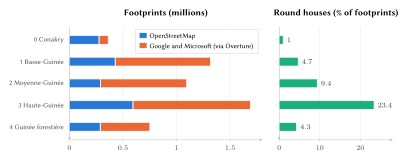
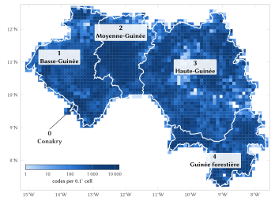
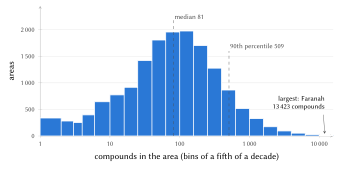
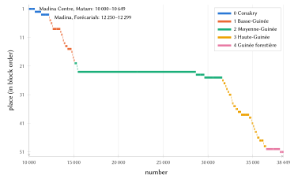
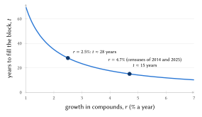
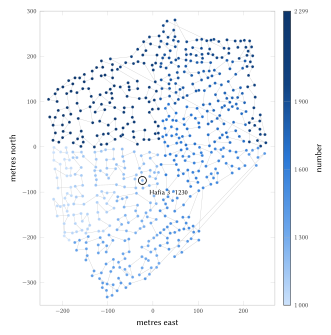
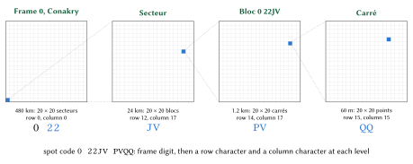

# Introduction

## The problem

An address does three things. It lets a person say where they live, it lets someone else find the place, and it lets an institution keep a record that refers to that place and to no other. Guinea has no system that does all three for homes. Its postal operator routes mail to post-office boxes behind a three-digit radical that names a delivery office, not a place [@upu2005gin]. A national programme named and signposted the streets of Kaloum, the capital's central commune, in 2024, but numbered no door [@africaguinee2024]. Outside Kaloum, a delivery rider, an ambulance crew or a visiting relative finds a home by telephone call and landmark.

The country is also changing quickly. The preliminary results of the fourth General Population and Housing Census (RGPH-4) counted 17,521,167 inhabitants in 2025, against 10,523,261 in 2014 [@bangoura2026; @citypopulation2026]. Conakry went from five communes to thirteen in 2024 [@guineenews2024loi; @guineenews2024communes], and the decrees of August 2026 created ten regions and forty-four préfectures out of eight and thirty-three [@focusguinee2026]. An address scheme that embeds any administrative unit would already have been wrong twice.

## Contribution

This paper describes an addressing model built for Guinea and issued for every compound in the country. Its contributions are:

1. a code that people can say and remember (a place name in daily use and a number read in pairs) and that is nevertheless unique nationally without a commune or préfecture, through one national number range per name divided into frozen blocks (Section 4.7);
2. a numbering along a Hilbert curve that keeps neighbours on nearby numbers and leaves room for new homes without renumbering (Sections 4.8 and 4.9);
3. a frame system that follows the postal regions rather than administrative units, so that no reform changes any code (Section 4.3);
4. a method for grouping building footprints into compounds suited to Guinean settlement, from the walled plot of Conakry to the round-house concession of the savanna (Section 4.13);
5. an open reference engine, a registry of all 3,808,784 codes, and a deployable server that reproduces the issuer's decisions exactly (Section 5); and
6. a measured evaluation and an estimate of benefits for four groups of users (Sections 6 and 8 to 11).

## Structure of the paper

Section 2 reviews Guinea's postal, address and land systems and the international literature. Section 3 describes the data. Section 4 defines the model with its formulas and worked examples. Section 5 describes the implementation and Section 6 the measured properties. Section 7 sets out the designs we considered and rejected. Sections 8 to 11 estimate the benefits for citizens, logistics, emergency services and government. Section 12 covers privacy and governance, Section 13 the limitations, and Section 14 concludes.

# Background and related work

## Guinea: population, settlement and languages

Guinea covers 245,857 km² between the Atlantic and the sources of the Niger [@citypopulation2026]. RGPH-4 counted 38.7 % of the population as urban and 43 % as under fifteen years of age [@bangoura2026]. Conakry, within its new boundary of thirteen communes, holds 3,407,327 inhabitants, about one Guinean in five; its largest communes are Gbessia (520,284), Kagbélen (395,370) and Lambanyi (385,884) [@citypopulation2026]. The two census totals imply average growth of about 4.7 % a year between 2014 and 2025, faster than most earlier projections; the preliminary status of the 2025 figures is one reason we also work with a lower rate of 2.5 % below.

Four natural regions structure everyday geography: Guinée maritime (Basse-Guinée), the Fouta Djallon highlands of Moyenne-Guinée, the savanna of Haute-Guinée, and Guinée forestière. The constitution of 26 September 2025 makes the national languages official alongside French, which remains the working language [@constitution2025]. Pular, Maninka and Susu are the most widely spoken, with Kissi, Kpelle (Guerzé) and Toma (Loma) in the forest region. A large share of adults read French with difficulty, but almost everyone handles telephone numbers, which Guineans read in pairs of digits.

## Postal radicals

The Universal Postal Union's addressing sheet for Guinea defines the postal code as three digits followed by a post-office box number, to the left of the locality, as in `001 BP 457 CONAKRY` [@upu2005gin]. The three digits form the *radical*, which routes an item to a delivery office; the box number is the *suffix*, which delivers it. The first digit is the postal region: 0 Conakry, 1 Basse-Guinée, 2 Moyenne-Guinée, 3 Haute-Guinée and 4 Guinée forestière. The radical identifies an office rather than a place, so two households that rent boxes at one office share it however far apart they live. The postal operator's own website offers boxes, parcels and express mail but does not use the term *code postal* [@laposte2026], and the regulator's 2025 call for a review of the postal sector does not mention addressing [@arpt2025].

## Street addressing in Conakry, 1993–2024

Guinea was among the first countries in West Africa to address its capital city. With World Bank support under the Second Urban Development Project, beginning in 1993, a municipal addressing unit mapped Conakry's five communes, coded every street with the initials of its commune and a number (`KA.23` is the twenty-third street of Kaloum), numbered doors metrically, and published an address map and street index [@farvacque2005, pp. 65–69]. The review of that work records two lasting applications. Addressing defined the zones and routes of a household-waste collection system run by small enterprises, after which the collection rate rose from 20 % to 80 %; and it guided the opening of secondary roads into neighbourhoods that the technical departments had not previously been able to locate [@farvacque2005, pp. 68–69]. The same review notes that, before addressing, fewer than 40 % of tax assessment notices issued in Conakry were collected [@farvacque2005, p. 65].

The street codes of that period survive on today's map (OpenStreetMap carries names such as *Rue KA. 040*), but door numbers did not: across the whole country, only 457 mapped objects carry a house number. In October 2024 the Minister of Urbanism and Housing described a new presidential addressing programme in which the avenues of Kaloum had been named and plated, with Dixinn and Matam, the rest of Conakry, Coyah, Dubréka and then the regional capitals to follow, together with an offline geolocation application [@africaguinee2024]. We found no evidence, by October 2026, of door numbering or of extension beyond Kaloum.

## Administrative boundaries in motion

The law voted on 18 January 2024 created seventeen new communes [@guineenews2024loi]; Ratoma was divided into Ratoma, Lambanyi and Sonfonia, and Matoto into Matoto, Gbessia and Tombolia [@guineenews2024communes]. The communal elections of 31 May 2026 were held in thirteen communes of Conakry [@guineenews2026elections]. The decrees of August 2026 created the regions of Beyla and Siguiri and brought the number of préfectures to forty-four [@focusguinee2026]. ISO 3166-2 does not yet list the new units. Any code that carries a commune, préfecture or region would have changed twice in three years.

## Land, census and personal data

RGPH-4 is the closest official dataset to a register of dwellings, but its enumeration maps are not public. The Code foncier et domanial [@ordonnance1992] registers titled land in a *livre foncier*; most land is held under custom or under a *permis d'habiter*. Cadastral plans use the Dabola 1981 datum with UTM zone 28N [@epsg3461]. Personal data are governed by Loi L/2016/037/AN, which requires a prior declaration of processing and authorisation for transfers abroad [@loi2016]; a decree of April 2025 sets security conditions for civil-status and identification data [@decret2025].

## International practice in addressing

The World Bank's review of street addressing in fifteen African countries, including Guinea, reports an average cost of US\$5.7 per addressed doorway and US\$0.6 per inhabitant, at 2005 prices, over twenty-one cities that completed their programmes [@farvacque2005, p. 49]. Its central lesson is that addressing decays when it is not used, and that its value lies in the services built on it: tax rolls, utilities, waste collection and planning. The Universal Postal Union frames addressing as public infrastructure and documents national programmes on several continents [@upu2012]. Its standard S42 defines the components of postal addresses and the templates by which each country renders them [@upus42], and ISO 19160-1 provides a conceptual model of address information that includes address aliases and life cycles [@iso19160]. Both standards describe how addresses are structured and exchanged; neither prescribes how a country without addresses should create them. The model presented here can be described in their terms: a place name and a number as the locator, the official street as an alias where one exists, and a status that records each address's life cycle.

## Grid codes and national digital addresses

A second family of systems derives a code from coordinates. Open Location Code (Plus Codes) encodes latitude and longitude in a 20-symbol alphabet and works anywhere, offline, from an open algorithm [@olc]. In 2017 Ghana introduced a national digital address computed from a grid of 5 m squares [@bokpe2018]. Such codes are precise and need no registry, but they name a square rather than a home, they carry letters that must be spelled, and they mean nothing to the person who lives there. In French, the letter names of G and J, M and N, and B, D, P, T and V are easily confused over a telephone line. For these reasons the model keeps a grid code, the spot code of Section 4.12, for places without a home and for machines, but does not ask people to remember it.

## The precedence of official addresses

One rule governs how the model relates to the state's own work: where an official address exists, it is used and shown first, as the state writes it. In Kaloum, every compound within 30 m of a named street shows that street first ("Avenue Dinah Salifou, Kaloum"), with the code beside it to tell the doors apart; this applies to 3,085 of Kaloum's 5,646 compounds. When door numbers or new communes are added by the national programme, those addresses will be shown first and the codes become cross-references; no issued code changes. A post-office box is a mailbox, never an address; only its radical's first digit survives in the model, as the frame number.

# Data and sources

## Building footprints

The model uses the 5,218,074 building footprints that lie inside Guinea's national border or within 300 m of it (Section 3.3): 1,873,398 from OpenStreetMap [@geofabrik2026] and 3,344,676 from the machine-detected footprints of Google Open Buildings [@sirko2021; @openbuildings] and Microsoft [@microsoft2023], distributed through the Overture Maps buildings theme [@overture2026], where they do not duplicate an OpenStreetMap footprint. Figure 1 shows the share of each source by frame. OpenStreetMap dominates in Conakry, where volunteers have traced most buildings; elsewhere the detected footprints supply most of the map.

{width=100%}

Half of all footprints are smaller than 44 m², and the median is 25.0 m² in Haute-Guinée against 68.8 m² in Conakry, a difference that reflects the round houses of the savanna and the rectangular concrete houses of the capital. The detected footprints carry a height attribute, but in Guinea its values are a rendering default: thirty-six values spread evenly between 3.5 and 7.0 m, each on about 98,000 footprints. We therefore do not use it, and the number of floors is known only for the 334 buildings where OpenStreetMap records it.

## Places and quartiers

OpenStreetMap holds the outlines of 397 official quartiers at administrative level 10, 128 of them within Conakry's frame, with others in Nzérékoré, Coyah, Kankan and other towns. Outside these outlines, places are named from OpenStreetMap's place nodes (towns, villages, hamlets, suburbs and neighbourhoods) and from the populated places of GeoNames [@geonames2026] that OpenStreetMap lacks, which together give 16,649 localities within 1.1 km of a Guinean frame. Labels for communes and préfectures come from the administrative boundaries in the same extract.

## The national border

The country's extent is taken from OpenStreetMap's national boundary of Guinea (administrative level 2, relation 192778), not from any zone outline. The frame outlines of Section 4.3, and outlines from other sources such as geoBoundaries and GADM, follow the border only approximately and cross it in places. The rule is therefore that the border decides: a building whose centre, or a compound whose entrance, lies more than 300 m outside the national border is in a neighbouring country and receives no code, whatever any outline says. The 300 m margin absorbs the drawing error of the line and a compound that straddles it. The registry build drops such buildings before any place or number is given, and the issuer and the registry server refuse a new code or a moved entrance there. The engine ships the border simplified by Douglas–Peucker at 5 m, a file of 0.6 MB whose largest distance from the true line, measured both ways, is $\delta = 5.5$ m; it accepts a point within $300 - \lceil \delta 
ceil = 294$ m of the simplified line, so that nothing more than 300 m outside the true border is ever accepted.

## Enclosures, sites and streets

Walls, fences and hedges mapped as closed rings, farmyards and small residential plots identify compounds directly where they exist. Schools, hospitals, mosques, markets, police posts and industrial sites mapped as areas define sites. Named streets in Kaloum supply the official street addresses. All inputs were taken from the OpenStreetMap extract of 17 October 2026.

## Reproducibility

The published registry, the place table and the model files are sufficient to reproduce every figure and table in this paper. The scripts that built the inputs, grouped the compounds and computed the statistics are in the repository's `tools/` directory, and `tools/paper-figures.py` computes the data behind each figure from the published files alone [@nwaysgn2026].

# The model

## Requirements

The model was designed against ten requirements, in order of priority:

1. **Memorable and effortless.** A code is a place name already in use and a number read in pairs; obtaining it takes one action.
2. **Unique on its own.** The remembered code identifies one home in the whole country, with no commune, préfecture or region added.
3. **The compound, ending at its gate.** The addressed unit is the concession or walled plot, not a single roof; buildings are sub-units; navigation ends at the gate.
4. **Official first.** Where the state has an address, it takes precedence.
5. **No administrative boundary inside a code.** Reforms change labels, never codes.
6. **Offline.** Spot codes, bloc codes and check digits can be computed without a network.
7. **Stable.** A code never moves and is never reused.
8. **Places, not people.** No resident's name or personal detail is stored.
9. **Open and transferable.** The engine, the registry and the rules are published under open licences and can be transferred to the state.
10. **Specific to Guinea.** Every rule is chosen for Guinea's settlement, languages and institutions.

## The forms of a code

Each compound has one code, written in several forms (Table 1).

| Form | Example | Used by |
|:-----|:---------|:-----------|
| Remembered | Hafia 3 · 1230; Linsan 5389 | people: spoken, typed, written on a parcel |
| Plate | HAFIA 3 · 1230 | gate plates, stickers, forms |
| Machine | GN-04261-1230-8 | applications, QR codes, partner systems |
| Structure | Hafia 3 · 1230.2 | the second building of the compound |
| Spot | 0 22JV PVQQ | any 3 m square, with or without a home |
| Bloc | 0 22JV | the 1.2 km square around it |

: The forms of one code.

Let $P$ be the place's plate name, $N$ the number ($1000 \le N \le 99\,999$), $F$ the five-digit national identifier of $P$'s name, and $c$ the check digit of Section 4.11. The three main forms are

$$
\text{remembered} = P \,\cdot\, N, \qquad
\text{plate} = \operatorname{upper}(P) \,\cdot\, N, \qquad
\text{machine} = \texttt{GN-}F\texttt{-}N\texttt{-}c,
\tag{1}
$$

where the separator "·" is written only when $P$ ends in a digit and a space is used otherwise. People never see the check digit: it exists only in the machine form. The machine form carries no frame, commune or préfecture, because the number's block identifies the place (Section 4.7).

## Frames

The country is covered by five frames, numbered with the first digit of the postal radical (Figure 2). Each frame's outline is the union of its regions as they stood in October 2026, simplified to about 22 m and frozen at the first issue. The regions of Beyla and Siguiri, created inside existing frames, therefore move no point from one frame to another.

{width=92%}

| Digit | Frame | Regions (2026) | Extent (km) | Compounds |
|:-:|:--|:--|--:|--:|
| 0 | Conakry | Conakry | 41 × 36 | 258,080 |
| 1 | Basse-Guinée | Boké, Kindia | 356 × 403 | 1,003,774 |
| 2 | Moyenne-Guinée | Labé, Mamou | 212 × 286 | 811,367 |
| 3 | Haute-Guinée | Kankan, Faranah, Siguiri | 400 × 435 | 1,195,252 |
| 4 | Guinée forestière | Nzérékoré, Beyla | 338 × 265 | 540,311 |
| | **Guinea** | | | **3,808,784** |

: The five frames.

Let $O_d$ be the outline of frame $d$ and $\operatorname{dist}$ the distance in degrees. A point $p$ belongs to the frame

$$
\operatorname{frame}(p) =
\begin{cases}
\min\{d : p \in O_d\} & \text{if } p \text{ lies in some outline},\\
\arg\min_d \operatorname{dist}(p, O_d) & \text{if } \min_d \operatorname{dist}(p, O_d) \le 0.01^\circ,\\
\text{none} & \text{otherwise.}
\end{cases}
\tag{2}
$$

Conakry's outline lies within the bounding box of Basse-Guinée, so the lower digit is taken first. The 0.01° tolerance (about 1.1 km) assigns islets and slivers between outlines to the nearest frame. Préfectures would have been a poor anchor: a Kankan key in a code would mislead residents of the new Siguiri region the day its signs change.

**The border decides.** Eq. (2) gives a frame, not a country: along the land border an outline and its 0.01° tolerance can reach into a neighbouring country. A point $p$ can therefore receive a code only if $\operatorname{frame}(p)$ exists and $d_B(p) \le 300$ m, where $d_B(p)$ is the distance from $p$ to the area enclosed by the national border $B$ (zero inside it; Section 3.3). Spot codes are not restricted: they name squares, not homes.

## Places

The place in a code is chosen by one rule with two sources, because Guinea records its places in two ways. Where an official quartier outline exists, a compound whose centre lies inside it belongs to that quartier. Elsewhere, the compound belongs to the nearest named locality, so that each locality governs its Voronoi cell. A town node with three or more quartier nodes within 5 km is dropped, because its quartiers name its parts, and a locality across the border names no Guinean home. Formally, for a compound $c$ with centre $\bar{x}(c)$, quartier outlines $Q$ and localities $L$,

$$
\operatorname{place}(c) =
\begin{cases}
q & \text{if } \bar{x}(c) \in q \text{ for some } q \in Q,\\
\arg\min_{l \in L} \lVert \bar{x}(c) - l \rVert & \text{otherwise.}
\end{cases}
\tag{3}
$$

The inventory holds 17,044 places, 395 named quartiers and 16,649 localities, of which 15,822 hold compounds. Places are frozen at the first code: if a commune renames a quartier, the new name becomes the display name and the old one remains valid; if it divides or merges quartiers, issued codes stay with the place that issued them. Figure 3 shows how many compounds a place holds. The distribution is wide: the median place holds 81 compounds and the 90th percentile 509, while towns that the map records as a single locality, such as Faranah (13,423), hold the most.

{width=88%}

## Plate names

The name in a code must be short enough to say with a number. A candidate name $s$ is acceptable as a plate name when

$$
\operatorname{ok}(s) \iff \lvert \operatorname{NFC}(s) \rvert \le 12 \;\wedge\; \lvert \operatorname{words}(\operatorname{base}(s)) \setminus \Lambda \rvert \le 2 \;\wedge\; \operatorname{base}(s) \text{ contains no digit},
\tag{4}
$$

where $\lvert\cdot\rvert$ counts characters after Unicode NFC normalisation (an accented letter counts once), $\operatorname{base}(s)$ is $s$ without a trailing quartier number ("Hafia 3" gives "Hafia"), and $\Lambda = \{\text{de, du, des, la, le, l', d', à, es}\}$ is the set of linking words, which do not count. A quartier's own number counts as characters but not as a word.

A name that fails Eq. (4) goes through fixed steps. A documented short form people already use would be taken first; none is asserted for Guinea, so the rule starts with cleaning: text in brackets or after a slash, and generic words such as Quartier, Cité, Lotissement, Zone, Secteur, Village, Campement, District and Base vie, are removed, and Saint may become St. If the result still fails, every run of one or two whole words that satisfies Eq. (4) is a candidate, ranked by how rare its words are among the country's place names:

$$
\rho(C) = \frac{1}{\lvert \operatorname{words}(C) \rvert} \sum_{w \in \operatorname{words}(C)} f(w),
\tag{5}
$$

where $f(w)$ is the number of place names in Guinea that contain the word $w$. The candidate with the lowest $\rho$ is chosen if it is clearly ahead of the next, with a preference for the end of the name, which in the Fouta and in Haute-Guinée is usually the hamlet's own. Thus "Missidé Bhoundou Kalouma" becomes *Kalouma* and "Matoto Khabitaya" becomes *Khabitaya*. A word is never cut, and a title never leaves its name (Tierno, Karamoko, Almamy, Dar es Salam, Château d'Eau).

A place is referred to its commune, with up to three candidates, when every short form drops a word that distinguishes two places (Maninka *koura* "new" and *kôrô* "old"; Foula or Malinké; and the landmark words that Conakry uses for sibling quartiers: Centre, Marché, Mosquée, École, Plateau, Cité, Minière, Routière), when the short form would equal a well-known town elsewhere, and for long hyphenated or doubled names ("Kélou Kélou" is never split).

| Places in use | Count |
|:-----------|--:|
| Plate name equal to the official name | 14,462 |
| Shortened by rule (distinctive words 738, cleaned 60, Saint to St 2) | 800 |
| Referred to the commune with candidates | 746 |
| of which no form satisfies Eq. (4) yet | 380 |
| Official names over 12 characters / over 2 words | 1,537 / 68 |

: Plate names of the 15,822 places in use.

The 746 referred places carry their first candidate as a provisional plate name: 304,656 codes were issued with a name that the commune may change once. The number never changes, and the official name remains an alias, so that "Missidé Bhoundou Kalouma 1260" finds *Kalouma 1260*. Of the official names that differ from their plate name, 1,150 are kept as aliases; 6 are not, because two plate names would claim them. Most of the 380 places without a fitting form have single Maninka names ending in *-dougou*, longer than twelve letters.

## The name key

Two names that look or sound alike must never be distinguished by the reader alone, so they share one *name key*, and every place with that key shares one national number range. The key is the composition

$$
\kappa(s) = (\delta \circ \nu \circ \sigma \circ \gamma \circ \beta \circ \pi \circ \lambda \circ \alpha \circ \ell)(s),
\tag{6}
$$

whose steps are given in Table 4, applied from right to left.

| Step | Rule | Example |
|:----|:----------|:-------|
| $\ell$, latin | Cyrillic look-alike letters read as Latin | Сondetta → Condetta |
| $\alpha$, $\lambda$ | accents and case removed | Missidè → misside |
| $\pi$, punctuation | hyphens, apostrophes, dots and brackets become spaces | Dar-Es-Salam → dar es salam |
| $\beta$, glue | a number attached to a word is separated | Soro2 → soro 2 |
| $\gamma$, generic | a leading quartier, village, secteur, district or cité is dropped | Quartier Hafia 3 → hafia 3 |
| $\sigma$, saints | St and Ste expanded | St-Antonin → saint antonin |
| $\nu$, variants | iya → ia, kh → k | Hafiya → hafia |
| $\delta$, doubles | doubled letters made single | Tannérie → tanerie |

: The steps of the name key, Eq. (6).

A trailing number stays part of the name: *Hafia 3* is a name of its own and *Hafia* another. The folding is deliberately generous. Joining two names costs only a longer range, whereas keeping apart two names that sound alike would give two homes the same spoken code. The 17,044 places fold to 12,142 name keys, of which 11,518 hold compounds. 2,209 keys are shared by two or more places with homes, covering 6,513 places; 1,137 of these span more than one préfecture. Madina is the most repeated, with 51 places in Conakry's Matam and in a dozen préfectures.

## National ranges and frozen blocks

Because a name is spoken without its commune, every place that shares a name key draws its numbers from one national range, divided into one block per place. A number lies in exactly one block, so a name and a number decode to exactly one place.

**Block size.** A place with $n$ compounds at first issue receives a block of

$$
b(n) = \max\!\left(50,\; 50 \left\lceil \frac{2n}{50} \right\rceil \right)
\tag{7}
$$

numbers: twice its compounds, rounded up to a multiple of fifty. The factor of two matters because numbering spreads the compounds evenly over the block (Section 4.8): every gap between neighbours keeps, on average, one free number for a house built between them.

**Range.** Let the places sharing a key be ordered by frame digit, then by their position on a Hilbert curve over the country, then by identifier, with blocks $b_1, \dots, b_k$. The blocks follow one another from a start $R$:

$$
s_1 = R, \qquad s_{i+1} = s_i + b_i, \qquad
R =
\begin{cases}
1000 & \text{if } \sum_i b_i \le 9000,\\
10\,000 & \text{if } 9000 < \sum_i b_i \le 90\,000.
\end{cases}
\tag{8}
$$

A name has four digits if its blocks fit in 9,000 numbers and five otherwise. Numbers never begin with 0, a digit that forms, text messages and speech tend to drop. A name whose places together needed more than 90,000 numbers would take a qualifier that people already use; none does.

**Worked example: Hafia 3.** Hafia 3, a quartier of Dixinn in Conakry, had $n = 645$ compounds at first issue, and no other place shares its key. Eq. (7) gives $b = \max(50, 50 \lceil 1290/50 \rceil) = 50 \cdot 26 = 1300$, so its block is 1000–2299.

**Worked example: Linsan.** Two places share the name, in two préfectures (Table 5). Their blocks need 6,650 numbers, so Linsan has four digits. *Linsan 5389* lies in Kindia and *Linsan 7031* in Lélouma; neither needs its préfecture.

| Place | Préfecture | Compounds | Block |
|:--|:--|--:|:--|
| Linsan | Kindia | 2,707 | 1000–6449 |
| Linsan | Lélouma | 591 | 6450–7649 |

: The national range of the name Linsan.

**Worked example: Madina.** Fifty-one places share the name, with 13,565 compounds. Their blocks need 28,450 numbers, so Madina has five digits, from 10000 to 38449 (Figure 4): Madina Centre in Matam holds 10000–10649 and a Madina of Forécariah 12250–12299.

{width=100%}

**Results.** 11,416 names in use have four digits and 102 have five. By compound, 3,048,246 codes (80.0 %) have four digits and 760,538 (20.0 %) five. Five-digit numbers belong to names shared by many places (Madina, Misira, Balandougou) and to the large places that the map records as one locality or one quartier (Faranah, Mamou, Lola, Kindiadi). The largest range is that of Kindiadi: three places with 15,054 compounds and 30,200 numbers.

**Growth.** At first issue a place uses half of its block, so it can hold twice its present compounds before it needs another block. With compound growth $r$ per year, the time to fill the block is

$$
t(r) = \frac{\ln 2}{\ln(1 + r)},
\tag{9}
$$

which gives $t \approx 15$ years at $r = 4.7\,\%$, the rate implied by the two censuses, and $t \approx 28$ years at $r = 2.5\,\%$ (Figure 5). A place that fills its block takes a further block after the last block of its name, sized again by Eq. (7); a four-digit name that passes 9999 continues into five digits. No issued code changes. Name identifiers, ranges, blocks and place indexes were frozen at the first issue, and a block is never moved, renumbered or reduced.

{width=72%}

## Numbering along a Hilbert curve

Inside its block, a place's compounds are numbered along a Hilbert curve [@hilbert1891], so that neighbours on the ground receive nearby numbers, as house numbers do along a street. Among space-filling curves, the Hilbert curve best preserves locality: a compact region is cut into the fewest separate runs of the curve [@moon2001].

**The grid.** Each frame has a grid of 3 m cells, the same grid as the spot code (Section 4.12). Let $(\varphi_S, \lambda_W)$ be the frame's south-west corner and $\varphi_r$ its reference latitude. A compound's point $(\varphi, \lambda)$, which is the footprint-weighted centre of its buildings until its gate is confirmed, falls in the cell

$$
i_\varphi = \left\lfloor \frac{\varphi - \varphi_S}{\Delta\varphi} \right\rfloor, \qquad
i_\lambda = \left\lfloor \frac{\lambda - \lambda_W}{\Delta\lambda} \right\rfloor, \qquad
\Delta\varphi = \frac{3}{m_\varphi(\varphi_r)}, \qquad
\Delta\lambda = \frac{3}{m_\lambda(\varphi_r)},
\tag{10}
$$

where the lengths in metres of one degree of latitude and longitude are

$$
\begin{aligned}
m_\varphi(\varphi) &= 111\,132.954 - 559.822 \cos 2\varphi + 1.175 \cos 4\varphi,\\
m_\lambda(\varphi) &= 111\,412.84 \cos \varphi - 93.5 \cos 3\varphi + 0.118 \cos 5\varphi.
\end{aligned}
\tag{11}
$$

**The curve.** The cell's position $h$ on a Hilbert curve of order 18, which has $2^{18} = 262\,144$ cells a side and so covers a frame's 160,000, is computed bit by bit from the most significant bit, with $x = i_\lambda$, $y = i_\varphi$ and $h = 0$ initially. For $s = 2^{17}, 2^{16}, \dots, 1$:

$$
\begin{aligned}
r_x &= [\,x \wedge s \ne 0\,], \qquad r_y = [\,y \wedge s \ne 0\,], \qquad h \leftarrow h + s^2 \bigl( (3 r_x) \oplus r_y \bigr),\\
(x, y) &\leftarrow
\begin{cases}
(s - 1 - y,\; s - 1 - x) & \text{if } r_y = 0 \text{ and } r_x = 1,\\
(y,\; x) & \text{if } r_y = 0 \text{ and } r_x = 0,\\
(x,\; y) & \text{if } r_y = 1,
\end{cases}
\end{aligned}
\tag{12}
$$

where $\wedge$ is the bitwise AND, $\oplus$ the bitwise exclusive OR, and $[\cdot]$ equals 1 when its condition holds and 0 otherwise.

**First issue.** The $n$ compounds of a place with block $[s, s + b)$, sorted by $h$ and then by a stable identifier, receive

$$
N_i = s + \left\lfloor \frac{(2i + 1)\, b}{2n} \right\rfloor, \qquad i = 0, 1, \dots, n - 1,
\tag{13}
$$

so the numbers are spread evenly, about $b/n$ apart, and every gap stays open.

**Worked example: Hafia 3 · 1230.** The compound's point is $\varphi = 9.5682034$, $\lambda = -13.6544537$. Conakry's frame has $\varphi_S = 9.43$, $\lambda_W = -13.85$ and $\varphi_r = 9.59$, so Eq. (10) gives $\Delta\varphi = 2.71235 \times 10^{-5}$ and $\Delta\lambda = 2.73289 \times 10^{-5}$ degrees, and the point lies in row $i_\varphi = 5095$ and column $i_\lambda = 7155$, at Hilbert position $h = 38\,448\,016$. Along the curve it is the 115th of Hafia 3's 645 compounds ($i = 114$), so

$$
N_{114} = 1000 + \left\lfloor \frac{(2 \cdot 114 + 1) \cdot 1300}{2 \cdot 645} \right\rfloor = 1000 + \left\lfloor \frac{297\,700}{1290} \right\rfloor = 1000 + 230 = 1230.
$$

Its neighbours along the curve are 1228 and 1232, and 1229 and 1231 remain free. Figure 6 shows the whole quartier: numbers rise smoothly through the quartier, and the occasional long segments are the points where the curve leaves one quadrant for the next.

{width=80%}

## Codes for new compounds

A new compound lies between two Hilbert neighbours in its place's block: $a$, the issued number at or just before its position on the curve, and $b$, the one just after. It takes the free number nearest the middle of their gap:

$$
N_{\text{new}} =
\begin{cases}
\arg\min_{m \in F,\; a < m < b} \left\lvert m - \left\lfloor \tfrac{a + b}{2} \right\rfloor \right\rvert & \text{if such } m \text{ exists},\\
\min F & \text{otherwise, if } F \neq \varnothing,\\
\text{the first number of a further block} & \text{otherwise,}
\end{cases}
\tag{14}
$$

where $F$ is the set of free numbers in the block, and the block's edges stand in for a missing neighbour. A house built between Hafia 3 · 1228 and 1230 receives 1229. The code can go on the gate the same day; it is provisional until residents confirm it (Section 12).

## Decoding without context

The last four or five digits are the number (they may be typed in pairs, "12 30", or after a "·"), the words before them are the name, the name key gives the national range, and the number gives the one block that holds it:

$$
\operatorname{decode}(P, N) = \bigl\{\, p : \kappa(P) \in \{\kappa(p)\} \cup \operatorname{aliases}(p),\; N \in \operatorname{blocks}(p) \,\bigr\}.
\tag{15}
$$

The blocks of one name never overlap, so the set has at most one member. A number in no block is refused, never guessed into a nearby place. A name ending in a number ("Hafia 3") is read with a "·" before the house number; if it is typed without one, every split is tried and exactly one must decode. An official name typed in full decodes only to its own place: "Madina Tossokere 2499" is refused, because 2499 belongs to Koula Tossokèrè in Labé. A commune or préfecture typed after a comma is shown but never needed.

## The check digit

The machine form ends with a check digit computed by Damm's algorithm [@damm2004]. Let the payload be the decimal string $d_1 d_2 \dots d_k = F \,\|\, N$ (with the structure number appended for a building of a compound). Then

$$
c_0 = 0, \qquad c_j = T[c_{j-1}][d_j] \quad (j = 1, \dots, k), \qquad c = c_k,
\tag{16}
$$

where $T$ is Damm's table of a totally anti-symmetric quasigroup of order 10:

$$
T = \left(\begin{array}{cccccccccc}
0&3&1&7&5&9&8&6&4&2\\
7&0&9&2&1&5&4&8&6&3\\
4&2&0&6&8&7&1&3&5&9\\
1&7&5&0&9&8&3&4&2&6\\
6&1&2&3&0&4&5&9&7&8\\
3&6&7&4&2&0&9&5&8&1\\
5&8&6&9&7&2&0&1&3&4\\
8&9&4&5&3&6&2&0&1&7\\
9&4&3&8&6&1&7&2&0&5\\
2&5&8&1&4&3&6&7&9&0
\end{array}\right).
$$

Each row and column of $T$ is a permutation, so every single wrong digit changes $c$; and $T$ is totally anti-symmetric, $T[T[c][x]][y] = T[T[c][y]][x] \Rightarrow x = y$, so every exchange of two different adjacent digits changes it too. Damm's construction meets the same goal as Verhoeff's dihedral-group scheme [@verhoeff1969] and Gumm's generalisation [@gumm1985] with a single table and no permutation step.

**Worked example.** The name Hafia 3 has the national identifier 4261, so the payload of Hafia 3 · 1230 is `042611230`. The successive states are

| $d_j$ | 0 | 4 | 2 | 6 | 1 | 1 | 2 | 3 | 0 |
|:--|:-:|:-:|:-:|:-:|:-:|:-:|:-:|:-:|:-:|
| $c_j$ | 0 | 5 | 7 | 2 | 2 | 2 | 0 | 7 | 8 |

: Damm states for the payload 042611230.

so $c = 8$ and the machine form is `GN-04261-1230-8`. A courier who copies 1203 for 1230 obtains check digit 7, not 8, and the code is refused.

**Errors in the remembered form.** The check digit is used only where codes are handled by machines; it is never printed on a plate and never needs to be remembered. In the remembered form, a block holds about twice its compounds, so a random one-digit slip inside a block reaches an issued compound with probability

$$
\Pr(\text{hit}) \approx \frac{n}{b} \approx \frac{1}{2}.
\tag{17}
$$

This is why every application shows the place, its préfecture and the gate before it navigates. Section 6.4 measures this probability on the registry.

## Spot codes and bloc codes

Every 3 m square in Guinea has a spot code, computed offline from its coordinates and written `D BBBB PPPP`: the frame digit and eight grid characters, without a check character for people to type. The alphabet `23456789CFGHJMPQRVWX` has twenty symbols; it contains no vowels, so no code spells a word in French, Pular, Maninka or Susu, and none of 0, O, 1, I and L.

**Nested squares.** Each frame is at most 480 km on a side: 400 blocs of 1.2 km, or 160,000 cells of 3 m. With row $i_\varphi$ and column $i_\lambda$ from Eq. (10), let $B_R = \lfloor i_\varphi / 400 \rfloor$, $B_C = \lfloor i_\lambda / 400 \rfloor$, $p_R = i_\varphi \bmod 400$ and $p_C = i_\lambda \bmod 400$. The eight character values are

$$
\left(
\left\lfloor \tfrac{B_R}{20} \right\rfloor,\;
\left\lfloor \tfrac{B_C}{20} \right\rfloor,\;
B_R \bmod 20,\;
B_C \bmod 20,\;
\left\lfloor \tfrac{p_R}{20} \right\rfloor,\;
\left\lfloor \tfrac{p_C}{20} \right\rfloor,\;
p_R \bmod 20,\;
p_C \bmod 20
\right),
\tag{18}
$$

a row and then a column at each level, like a draughtboard: characters 1–2 name the *secteur* (24 km), 1–4 the *bloc* (1.2 km), 5–6 the *carré* (60 m) and 7–8 the point (3 m), as Figure 7 shows.

{width=100%}

**Worked example.** Hafia 3 · 1230 lies in row 5095 and column 7155 of Conakry's frame, so $B_R = 12$, $B_C = 17$, $p_R = 295$ and $p_C = 355$. Eq. (18) gives the values $0, 0, 12, 17, 14, 17, 15, 15$, which are the characters `2 2 J V P V Q Q`. The spot code is `0 22JV PVQQ` and the bloc code is `0 22JV`.

**At a frame's edge.** A point outside every outline but within 0.01° of one belongs to the frame of the nearest outline (Section 4.3), yet it can lie just beyond that frame's grid, with $i_\varphi$ or $i_\lambda$ outside $0, \dots, 159\,999$: Basse-Guinée's grid begins at 9.03° N, while its outline reaches 9.0341° N. Such a point takes the grid of another frame whose outline lies within 0.01° and whose grid holds it, the one with the nearest outline (ties to the lower digit); failing that, it takes the cell of its own frame's grid nearest to it, $\bigl(\min(\max(i_\varphi, 0), 159\,999),\ \min(\max(i_\lambda, 0), 159\,999)\bigr)$. Distances are measured as for the frames, in degrees. No point within 0.01° of an outline lies more than 350 cells (1,050 m) beyond its frame's grid, so every point in Guinea has a spot code. The 1,972 issued compounds outside every outline all lie in their own frame's grid, so none takes an edge cell or another frame's grid; the registry keeps every entrance exactly in any case. Frames and grids never move, and a code decodes in the frame its digit names.

**The check character of a written code.** Spot codes are shared as links and are not normally written with a check character, but a code written with one, `D BBBB PPPP-C`, still decodes, and its check is verified. Each symbol value $v$ is read as $(v \bmod 5, \lfloor v/5 \rfloor)$, an element of the group $G = \mathbb{Z}_5 \times \mathbb{Z}_2^2$, the second component written as two bits. Let $\sigma$ be the automorphism of $G$ that acts as multiplication by 2 on $\mathbb{Z}_5$ and as the matrix $M = \left(\begin{smallmatrix} 0 & 1 \\ 1 & 1 \end{smallmatrix}\right)$ on $\mathbb{Z}_2^2$. With $x_1, \dots, x_9$ the frame digit followed by the eight grid values, the check character $c$ satisfies

$$
\sum_{i=1}^{9} \sigma^{i}(x_i) + \sigma^{10}(c) = 0 \quad \text{in } G.
\tag{19}
$$

Because $\sigma - 1$, $\sigma + 1$ and $\sigma^2 - 1$ are bijections of $G$, the check detects every single wrong character, every exchange of adjacent characters, every exchange across one character, and every twin error ($aa \to bb$), in the sense of Gumm's group-based check methods [@gumm1985]. For the example, $\sum \sigma^i(x_i) = (3, 2)$, so $\sigma^{10}(c) = (2, 2)$ and $c$ = `W`.

The bloc code names a 1.2 km square, roughly a village with its fields or part of a Conakry quartier. It is Guinea's first location code that no reform can change: a courier knows that two homes in the same bloc are within walking distance. Spot codes serve places without a home, such as a stall at Madina market, a gold-panning site near Siguiri or a landing on the Îles de Loos.

## From footprints to compounds

A Guinean home is a compound. In Conakry it is a walled plot with a gate, a main house, annexes for relatives or tenants, a kitchen and latrines, and often a shop opened in the street wall. In the Fouta Djallon and Haute-Guinée it is a family concession of round houses (*suudu* in Pular) with granaries and a kitchen, sometimes enclosed by a hedge or a fence of woven stalks and often not enclosed at all. Footprints are grouped into compounds before any number is given, one place at a time, after sorting them by a stable identifier, so that the result never depends on the order in which map data arrive.

**Settlement.** A footprint stands in a scattered settlement when fewer than four footprints per hectare surround it, and in a dense one otherwise, where the density is

$$
\rho_{\text{set}} = \frac{\text{footprints in its 50 m cell and the 24 cells around it}}{6.25\ \text{ha}}.
\tag{20}
$$

**Gap and shape.** For footprints $a$ and $b$ with centroids $\mathbf{c}_a, \mathbf{c}_b$, areas $A_a, A_b$ and perimeter $P_a$,

$$
g(a, b) = \lVert \mathbf{c}_a - \mathbf{c}_b \rVert - \tfrac{1}{2}\sqrt{A_a} - \tfrac{1}{2}\sqrt{A_b}, \qquad
\operatorname{round}(a) \iff \frac{4\pi A_a}{P_a^2} > 0.88 \;\wedge\; A_a < 60\ \text{m}^2,
\tag{21}
$$

and a footprint is small when $A_a < 40$ m². The grouping rules, applied in order, are given in Table 7.

| Rule | Condition | Effect |
|:--|:---------|:-----|
| Plot | centre inside the smallest mapped wall, fence or hedge ring (40–20,000 m²), farmyard (≤ 1 ha) or residential plot (≤ 2,500 m²) holding at most 25 footprints | the plot is one compound |
| Site | inside a school, hospital, mosque, market, police, military, government or industrial site with at most 30 footprints and 6 ha | the site is one compound |
| Concession | scattered settlement; round or small footprints with $g \le 10$ m, the group at most 60 m across | one concession, joined to the nearest larger house within 10 m if the whole stays within 60 m |
| Annex | $A < 40$ m² and $g \le 8$ m to a footprint at least twice its size | joins the nearest such footprint |
| Cap | a group of more than 12 footprints | re-linked with half the distances until every part fits |

: Rules for grouping footprints into compounds.

Three or more round houses in one compound make a *family concession*, the multi-household home of the Fouta and the savanna.

**Results.** The 5,218,074 footprints form 3,808,784 compounds, 1.37 footprints per compound. 2,898,820 compounds are a single structure, 616,433 have two, 185,665 three and 107,866 four or more. 174,513 are concessions and 24,050 family concessions; 13,029 come from mapped plots and 2,488 from sites. With RGPH-4's population, a compound holds on average 4.6 people.

| Frame | Compounds | Footprints | Per compound | Median footprint (m²) |
|:-------|-----:|-----:|-----:|------:|
| Conakry | 258,080 | 363,193 | 1.41 | 68.8 |
| Basse-Guinée | 1,003,774 | 1,317,552 | 1.31 | 50.7 |
| Moyenne-Guinée | 811,367 | 1,095,256 | 1.35 | 34.6 |
| Haute-Guinée | 1,195,252 | 1,690,541 | 1.41 | 25.0 |
| Guinée forestière | 540,311 | 751,532 | 1.39 | 40.6 |

: Compounds and footprints by frame.

## The building profile

Every structure carries a use class with its confidence and source, its size, its floors where known and a status; each compound aggregates its structures. Classes are inferred in a fixed order of evidence, each with its confidence: the OpenStreetMap building tag (0.9); its amenity, shop, office or tourism tags (0.85); a mapped compound or site (0.7); a named place inside the footprint (0.7); shape (0.5: under 12 m² inside a compound is an annex, round and under 60 m² a round house, and 1,500 m² or more on one or two floors a warehouse); and finally the default, a house (0.3).

| Class | Structures |
|:--|--:|
| house | 4,445,130 |
| round house (*case ronde*) | 596,703 |
| annex | 142,306 |
| under construction | 9,970 |
| industrial | 6,172 |
| school | 4,324 |
| shop | 2,999 |
| health | 1,991 |
| military | 1,524 |
| office | 1,375 |
| place of worship | 1,220 |

: The most frequent use classes.

Round houses are measured from shape, not assumed. 596,703 footprints satisfy Eq. (21): 11.4 % of all buildings, 23.4 % in Haute-Guinée, 9.4 % in Moyenne-Guinée and 1.0 % in Conakry; by préfecture they reach 54.7 % in Faranah, 37.5 % in Mandiana and 34.8 % in Dinguiraye. No home carries a personal name.

## Official streets in Kaloum

For every compound in Kaloum, the named street within 30 m of its buildings, the most frequent among them, is its official address, shown first and written as the programme and the map write it, for example "Avenue de la République, Kaloum". 3,085 of Kaloum's 5,646 compounds have one; the others stand on unnamed lanes. The code is shown beside the street name, to distinguish the doors of one street until the programme numbers them.

# Implementation

## Reference engine and conformance vectors

The engine is specified normatively in `engine/SPEC.md`. Its reference implementation, `gn_codes.py` with the plate-name rule `plate_names.py`, both in `engine/reference/`, is written in Python with the standard library only. The reference program parses and validates codes, computes spot and bloc codes, decodes remembered codes nationally, and reserves numbers for new compounds by Eq. (14). Its self-test proves exhaustively that the Damm digit detects every single error and every adjacent exchange in every four-digit number, and that the spot check of Eq. (19) detects every single error, adjacent exchange and exchange across one character on all 8,000 three-character bodies. The conformance file `vectors.json` lists inputs and expected outputs that every port of the engine must reproduce.

## The registry

The registry publishes every issued code: 3,808,784 rows, one per compound, in one gzip-compressed CSV file per frame, with the frozen place table and a manifest that gives the counts and the SHA-256 digest of every file. Each row gives the machine form, the remembered and plate forms, the place, the official name and label, the number and its check digit, the status, the date and mode of issue, the entrance and its kind, the spot code and Plus Code, the building profile and, in Kaloum, the official street. Nothing is withheld. The registry is published under the Open Database License, so that any institution can load it into its own systems.

## Registry server and API

The repository includes a server that anyone can deploy to answer queries from the registry and, if designated, to issue new codes. It uses only the Python standard library. Its import command verifies every file against the manifest's digests and counts before loading it into SQLite with indexes and a spatial index; its export command writes the registry back in the published format, and an export of an unmodified import is byte-identical to the published files. A JSON API serves health and metadata, full code records, search by any written form, the code at a point, codes near a point, verification, spot encoding and decoding, frames, places and paged listings, with a uniform error format. Issuing implements the rules of Sections 4.7 to 4.9, the national border of Section 3.3 and the issuer's duplicate checks; on 146 sequential test cases, which included compounds across the country, doors that filled two blocks in Kaloum, and three new extension blocks, it reproduced the N-Ways issuer exactly in number, forms, spot code and blocks. The server and its API are documented in `server/README.md`, `server/openapi.yaml` and `docs/api.md`.

A deployment issues codes only if the State or N-WAYS LIMITED has designated it as the country's issuer; otherwise it runs read-only. The reason is arithmetic: two issuers working from the same registry would each find the same free number for two different new homes.

## Worked examples from the registry

Table 10 lists real codes: the compound nearest each well-known place.

| Near | Code | Machine form | Shown with |
|:------|:-----|:------|:-------|
| Hafia 3, Dixinn | Hafia 3 · 1230 | GN-04261-1230-8 | Dixinn, Conakry |
| CHU de Donka | Camayenne 2936 | GN-01596-2936-5 | Dixinn, Conakry |
| Kaloum | Almamiya 1939 | GN-00053-1939-4 | Avenue Dinah Salifou, Kaloum |
| Dalein, Labé | Tata 1 · 7552 | GN-10762-7552-3 | Labé |
| Kankan | Farako 2 · 3494 | GN-03084-3494-8 | Kankan |
| Nzérékoré | Koléyeba 2377 | GN-05899-2377-6 | Nzérékoré |
| Siguiri | Energie 4058 | GN-02868-4058-9 | Siguiri |
| Faranah | Faranah 16351 | GN-03103-16351-3 | Faranah |
| Linsan, Kindia | Linsan 5389 | GN-07134-5389-6 | Kindia |
| Linsan, Lélouma | Linsan 7031 | GN-07134-7031-6 | Lélouma |
| Missidé Bhoundou Kalouma | Kalouma 1260 | GN-04730-1260-1 | Télimélé |

: Codes from the registry.

A moto-taxi driver who is told "Hafia 3, douze trente" types `hafia 3 12 30`, and the application shows the compound, Dixinn and the gate. Someone in Labé who types `linsan 7031` is taken straight to Lélouma, because 7031 lies in the block 6450–7649; `linsan 5389` lies in 1000–6449, in Kindia. "Missidé Bhoundou Kalouma 1260" and "Kalouma 1260" are the same home in Télimélé, while "Kalouma 1334" is a different Kalouma, in Mali préfecture, because its number lies in another block of the same name.

# Evaluation

## Uniqueness and coverage

Every one of the 3,808,784 compounds has a code, and no pair (name identifier, number) occurs twice in the registry; since the blocks of each name are disjoint and every number lies in its place's block, Eq. (15) returns exactly one place for every issued code. Every machine form in the registry matches the reference engine's recomputation. All codes are provisional and issued in bulk; none is retired. The 15,822 places in use cover all five frames, and the official street is attached to 3,085 compounds in Kaloum.

## Length of codes

Four-digit numbers cover 80.0 % of compounds and five-digit numbers 20.0 %. The remembered form has a median length of 13 characters including spaces; 99 % of codes have at most 19, and the longest, which carry provisional names awaiting a commune's choice, reach 27.

## Collisions avoided

To measure what the national ranges achieve, we compared them with the simplest alternative: each place numbering its own compounds from 1000 independently. Under that alternative, 821,703 compounds (21.6 %) would share their spoken code, place name and number, with a compound in another place of the same name. Under the model, none does.

## Error detection

Table 11 reports the detection rates of the Damm digit on 20,000 random nine-digit payloads, the length of a four-digit machine form, for each class of error. Single errors, adjacent exchanges and the "phonetic" errors common in French (13 for 30) are always detected; jump exchanges and twin errors are detected in about nine cases out of ten, as expected of any single decimal check digit.

| Error | Example | Detected |
|:--|:--|--:|
| single digit | 1230 → 1280 | 100 % |
| adjacent exchange | 1230 → 1203 | 100 % |
| phonetic | 13 → 30 | 100 % |
| twin | 11 → 22 | 91.6 % |
| jump exchange | 123 → 321 | 89.7 % |
| jump twin | 121 → 323 | 88.8 % |

: Detection by the Damm check digit, measured on 20,000 random payloads.

In the remembered form, which has no check digit, we replaced each digit of 20,000 random issued codes by every other digit. 40.3 % of these slips produced another issued code of the same name, close to the prediction of Eq. (17), and 35.2 % of adjacent exchanges did. The remaining slips are refused outright; for those that are not, the application's confirmation step (place, préfecture and gate) is the safeguard.

## Spatial accuracy

A spot code decodes to the centre of its cell, so the position error is at most half the cell's diagonal, $\tfrac{3}{2}\sqrt{2} \approx 2.1$ m, for every issued compound, since none has a code that names an edge cell (Section 4.12). Because each frame computes its cell size at its own reference latitude, cells remain within 1 % of 3 m across Guinea's latitudes. Against the issuer's own point lookup, the server's `/v1/at` endpoint returned the same compound for 94 of 100 sampled entrances and for 89 of 100 points 8 m away; the differences arise because the server tests issued entrances, whereas the issuer also tests building footprints, which the registry does not publish.

## Compound grouping

We re-ran the grouping rules on the 738 walls, fences, hedges and farmyards that mappers drew around two or more buildings, with the enclosures hidden from the rules, and compared the results. 12.3 % of enclosures came out whole, 9.9 % exactly, and a further 29 % missed only one building. Most of these enclosures are town walls (416) and fences (268): inside a Conakry wall the buildings stand apart, while neighbours across the wall stand close together, so the town rule is cautious by design. A wrong split costs little, because two codes later found to be one home are merged by making one an alias; a wrong merge would force a family to change its code.

# Designs considered

## Forms of the remembered code

Before choosing the form, we established the facts it had to respect (Table 12).

| Question | Finding | Consequence |
|:------|:-------|:-------|
| Are there postcodes? | radicals that name post offices | the radical's first digit is the frame |
| Are doors numbered? | no; 457 house numbers in the whole map | the code cannot depend on streets |
| Are boundaries stable? | 5 → 13 communes (2024); 44 préfectures (2026) | no administrative unit in any code |
| Which units do people know? | natural region; quartier, district, village | five frames; the place name |
| Are place names unique? | no: Madina in 51 places | one national range per name |
| How are numbers said? | in pairs, as telephone numbers | four digits, two pairs |

: Findings that constrained the design.

Table 13 compares the forms we considered.

| Option | Example | Reason for rejection |
|:-------|:-----|:----------|
| alphanumeric grid code | 0 22JV PVQQ | ten symbols with letters spelled aloud; kept as the spot code |
| national digits only | 0 0421 2471 | nine digits with nothing to anchor them; one wrong digit lands in another town |
| préfecture key and digits | KA 2471 | too small (Siguiri préfecture alone has 384,766 buildings) and made obsolete by the 2026 reform |
| bloc and digits | 2 Q7M3 471 | blocs are not names people use |
| place and number, with the préfecture | Linsan 471, Lélouma | not unique on its own |
| full official names | Missidé Bhoundou Kalouma 1260 | too long to say with a number |
| **plate name and number, one national range per name** | **Hafia 3 · 1230** | **chosen** |

: Forms of the remembered code that were considered.

## Alternatives within the chosen form

Four further alternatives were tested and set aside.

- **Blocks sized from buildings.** Sizing blocks from building counts divided by Conakry's measured 1.40 buildings per compound gives the wrong size wherever settlement differs from Conakry's. Blocks are instead cut from the compounds actually grouped, so that each place's block fits its homes.
- **A curve over each place.** Ordering compounds along a Hilbert curve over each place's own bounding box makes a compound's position depend on its neighbours: a new home outside the box would change the box. The model instead uses one curve per frame, over the same 3 m grid as the spot code, so a position never depends on anything but the point.
- **Floors from detected heights.** The detected footprints' heights would have given floor counts for most buildings, but in Guinea they are a constant filler and were rejected (Section 3.1).
- **A staged roll-out.** Issuing Conakry first and other cities later would have left most of the country without codes for years. Codes were issued for every compound at once with the cautious grouping rule, and later corrections become aliases rather than renumbering.

## Cost of the choices

Sharing a national range costs some places a fifth digit: 20.0 % of compounds have five-digit numbers, because 102 names are shared by many places or belong to very large places. Shortening names can make two names meet: "Madina Tossokere" (Fria) and "Koula Tossokèrè" (Labé) both become *Tossokere* and share one range, like any repeated name. In return, 80.0 % of homes have a number of two pairs, and no home needs anything but its place and its number.

The check digit is a decimal digit from Damm's quasigroup. No weighted sum modulo 10 detects every single error and every adjacent exchange; the alternatives are an eleventh symbol with a prime modulus, a non-abelian group as in Verhoeff's scheme, or a totally anti-symmetric quasigroup as in Damm's [@verhoeff1969; @gumm1985; @damm2004]. An eleventh symbol would be a letter, and a letter would reintroduce the confusions of spoken letter names; Damm's table is the simplest of the remaining two. The spot code already uses twenty letters and digits, so its check is one of the same twenty symbols, built on the group $\mathbb{Z}_5 \times \mathbb{Z}_2^2$ of order 20.

# Benefits to citizens

For a family in Hafia, in a concession of the Fouta or in a forest village near Macenta, a code changes four ordinary things.

**Being found.** A visitor, a moto-taxi or a delivery rider no longer needs to be guided landmark by landmark; one short phrase, "Hafia 3, douze trente", leads to the gate.

**Proving where one lives.** Banks, mobile-money agents, schools and employers ask for an address, and almost nobody in Guinea can give one that another person can check. Today 457 mapped objects carry a door number (about 0.01 % of compounds) and 3,085 compounds have an official street (0.08 %); every compound now has a code.

**Receiving goods and services.** Relatives abroad, shops, and water and electricity services can send to a code rather than a description, and a household can request a connection or a repair at the right gate.

**Simplicity.** Nothing is asked of the household. Every compound already on the map had its code from the first issue; a mobile application shows it in one action. A code is free, requires no document and holds no personal data. It is not a land title.

**Estimated impact on financial inclusion.** Account ownership among adults in Guinea rose from 30.4 % in 2021 to 36.0 % in 2024 [@wbfindex2026], and insufficient documentation is consistently among the main reasons that unbanked adults give for not having an account [@findex2022]. Let $A$ be the adult population, $o$ the share with an account, $d$ the share of unbanked adults for whom documentation is the barrier, and $a$ the share of those for whom a verifiable address is the missing document. The number of adults for whom the address barrier is removed is

$$
E = A\,(1 - o)\,d\,a.
\tag{22}
$$

With $A = 0.57 \times 17.52$ million $= 9.99$ million (the 57 % aged fifteen and over in RGPH-4 [@bangoura2026]) and $o = 0.36$, the assumptions $d \in [0.05, 0.30]$ and $a \in [0.25, 0.75]$ give $E$ between 0.08 and 1.44 million adults, with 0.48 million at the central values $d = 0.15$ and $a = 0.5$. This is an upper bound on the people whom an address helps, not a forecast of accounts opened.

**Who benefits most.** Those with least today: families in Conakry's fast-growing communes (Gbessia, Kagbélen, Lambanyi), villages of Haute-Guinée far from any landmark, mining towns that grow faster than any map, and adults who read French with difficulty, for whom a familiar place name and a number read like a telephone number are easier than letters.

# Logistics and commerce

Delivery in Guinea depends on the telephone. Market research on African courier operations reports first-attempt success rates as low as 60 % and an average cost of about US\$2.70 for one last-mile delivery attempt [@odeloye2023].

**What the code gives a logistics business.** The machine form is a stable key for a customer's compound, which can be stored, deduplicated and joined to past deliveries. The code resolves to the compound's gate, or to its centre until the gate is confirmed, so routes can be planned before the rider leaves. The check digit catches every single wrong digit and every adjacent exchange at data entry, not on the road. Because the registry, the engine and the rules are open, a courier, a shop, a bank or a payment provider can resolve codes in its own systems, offline, without a fee. Couriers can sort parcels by bloc code before knowing anything else, since two homes in one bloc lie on one round.

**Markets and mining towns.** The Madina, Niger and Taouyah markets of Conakry, and the weekly markets of every préfecture, can send goods and payments to a compound rather than to the nearest junction. Bauxite at Boké, Kamsar, Sangarédi and Fria, gold around Siguiri and iron at Simandou draw people into settlements that change month by month; new compounds receive codes as they appear (Section 4.9).

**Estimated savings.** Let $f_0$ be the share of first attempts that fail without a precise address, $\rho$ the share of those failures that a code removes, and $c$ the cost of an attempt. The saving per thousand deliveries is

$$
S = 1000\, f_0\, \rho\, c.
\tag{23}
$$

| $f_0$ | $\rho = 0.25$ | $\rho = 0.50$ | $\rho = 0.75$ |
|:--|--:|--:|--:|
| 0.20 | US\$135 | US\$270 | US\$405 |
| 0.30 | US\$203 | US\$405 | US\$608 |
| 0.40 | US\$270 | US\$540 | US\$810 |

: Saving per thousand deliveries by Eq. (23), with $c$ = US\$2.70.

The range of $f_0$ follows the reported first-attempt success of 60 % or more [@odeloye2023]; $\rho$ is an assumption, since some failures have causes other than location (an absent customer, a refused parcel). At the central values the saving is about US\$405 per thousand deliveries. These are industry estimates for African cities, not measurements in Guinea; Section 13 describes how we will measure them.

# Emergency services

An ambulance, a fire crew or a police patrol faces the same problem as a courier, with more at stake. A continent-wide survey of emergency medical systems found that, where they exist, basic technicians and basic life-support ambulances are the most common provision [@mouldmillman2017], and a qualitative study of the emergency medical service in Kigali found that crews and dispatchers lost time locating patients because they depended on local knowledge and needed several calls to pass the location [@hunt2023]. We know of no published measurement for Guinea, which is itself a reason to begin one.

**How a code helps a dispatcher.** The caller says one phrase, "Linsan, soixante-dix trente et un", and the registry returns one compound, in Lélouma rather than Kindia. The dispatcher reads back the place, its préfecture and the gate before anything is sent. The crew drives to the gate, and a spot code marks any point without a compound, such as a road accident on a national road. All of this works offline: the engine and the open registry files need no network.

**Estimated impact.** Larsen and colleagues modelled survival after out-of-hospital cardiac arrest as 67 % less 2.3 percentage points for each minute before cardiopulmonary resuscitation, 1.1 points for each minute before defibrillation and 2.1 points for each minute before advanced care [@larsen1993]. Where one crew brings all three, a reduction $\Delta t$ in the time spent locating the patient raises survival by

$$
\Delta S = (2.3 + 1.1 + 2.1)\,\Delta t = 5.5\,\Delta t \ \text{percentage points},
\tag{24}
$$

that is 5.5 points for $\Delta t = 1$ minute, 11 points for 2 minutes and 27.5 points for 5 minutes. The model was fitted in King County, Washington, so these values indicate an order of magnitude for Guinea rather than a prediction; the direction of the effect is not in doubt.

# Government coordination and planning

A code is a shared key. When ministries, communes, utilities and the Institut National de la Statistique refer to a compound by one code, their records can be joined without matching names and descriptions.

**Lessons from Conakry.** Guinea's own experience shows what an address register enables. In the 1990s, addressing defined the waste-collection zones of Conakry, after which collection rose from 20 % to 80 %, and it located neighbourhoods for road works that had previously been unreachable on paper [@farvacque2005, pp. 67–69]. The same review records that an address directory gives a list of premises more complete than the tax roll and shows who is missing from it [@farvacque2005].

**A code that outlives reforms.** Communes and préfectures are labels looked up from a compound's position, never part of its code. When the thirteen communes of Conakry or the forty-four préfectures are finalised, every code keeps working and shows its new commune, and the registry can count compounds by any boundary the State publishes.

**The census.** A correspondence between codes and RGPH-4 enumeration areas would let each serve the other: the census would give the registry its household counts, and the registry would give the census a frame of 3,808,784 compounds with stable codes, from which survey teams can sample and to which they can return, without storing any name.

**Planning with real counts.** The registry counts compounds by frame, préfecture, place, settlement type, round houses and building class, and every count can be recomputed from the open files. Siguiri préfecture, for example, holds 266,703 compounds and 384,766 buildings. Table 15 gives straight-line distances from compounds to the nearest mapped facility, on a sample of 20,000 compounds.

| Facility | Within 2 km | Within 5 km | Median distance |
|:--|--:|--:|--:|
| Health facility | 45.8 % | 69.3 % | 2.4 km |
| School | 38.3 % | 53.3 % | 4.2 km |
| Police | 13.4 % | 23.1 % | 25.7 km |
| Pharmacy | 19.8 % | 26.9 % | 26.6 km |

: Distance from compounds to the nearest mapped facility (sample of 20,000).

These figures describe the map as much as the country: police posts and pharmacies outside the towns are sparsely mapped, so their distances appear longer than they are, and the table shows where mapping is most needed. A ministry can substitute its own facility list and recompute the figures in minutes.

**Estimated cost avoided.** A conventional door-numbering survey of every compound would have cost

$$
C = N\,c_d,
\tag{25}
$$

where $N = 3\,808\,784$ is the number of compounds and $c_d$ the cost per doorway. With $c_d$ = US\$5.7, the average over twenty-one African cities, $C \approx$ US\$21.7 million at 2005 prices; with US\$7.6, the figure reported for one national programme in the same review, $C \approx$ US\$28.9 million [@farvacque2005, pp. 49, 76]. These figures exclude street naming and signposting, which outside Kaloum would come in addition.

# Privacy, safety and governance

**Privacy.** Codes describe places, never people. Residential compounds carry no names and no occupant data, and household counts are never inferred. Business and public buildings carry their public names. A household can ask for its gate to be hidden; the compound keeps its code, but its gate is no longer shown. Loi L/2016/037/AN requires a prior declaration of processing and authorisation for transfers abroad [@loi2016]; the registry holds no personal data, and its processing will be declared to the authority foreseen by the law once that authority is in place.

**Confirmation.** Every code starts as provisional. It becomes confirmed when residents agree in the application that it is right: two telephones, at least one at the gate, with most answers in agreement. Corrections to the gate follow the same consensus. A code is an address, not a land title, and an outline that overlaps another compound is flagged rather than issued.

**Governance.** N-WAYS LIMITED maintains the model and is the single issuer, so that no two homes share a code. Frames, issued codes, name keys and the blocks of each name never change; adding blocks is not a change. Building profiles change with evidence. A commune may rename a place (the old name becomes an alias and no number changes), choose a provisional short name once, or add places, which receive new blocks. If the State publishes an address system, its addresses are shown first and the codes become cross-references. The repository, the registry and the rules can be transferred to the State or a body it designates, under the open licences, without forking the engine.

# Limitations and future work

- **The place list is incomplete.** OpenStreetMap and GeoNames are uneven, and the communes' own quartier lists are needed, above all for towns mapped as a single locality, whose numbers have five digits.
- **746 short names are provisional** until the communes choose; 380 still have no form that satisfies Eq. (4).
- **Compounds are inferred.** Inside walled town plots, the rules find only one enclosure in eight whole (Section 6.6); residents' corrections and walls traced on imagery will improve this over time.
- **Gates are largely unknown.** Most codes lead to the compound's centre until couriers and residents confirm the gate.
- **Floors are unknown** for nearly all buildings, so floor areas are footprint areas.
- **Facilities are sparsely mapped,** so the access figures of Section 11 understate access.
- **Numerals in Pular, Maninka and Susu** have yet to be checked by native speakers.
- **Codes are unique within Guinea only.** A place name shared with a neighbouring country can carry the same spoken code there; applications show the country on every card.
- **Impact estimates rest on external parameters.** The delivery, emergency and inclusion figures use parameters measured elsewhere.

We will measure the model's effects directly (Table 16).

| Measure | Method | Target |
|:------|:-------|:-----|
| Recall of one's own code after one week | residents asked without the application, in French and their first language | at least 80 % exact |
| First-attempt delivery success | partner couriers, with and without a code | at least 20 points higher with a code |
| Time from arrival in the quartier to the gate | courier timestamps | halved |
| Gates confirmed | residents and couriers | 20,000 |
| Locating time for emergency calls | with a willing ambulance or fire service | measured, then halved |

: Planned measurements.

# Conclusion

Guinea has postal radicals, the streets of one commune and a long record of administrative change, but no address by which a home can be found. The model presented here gives every one of the country's 3,808,784 compounds a code that people can say (a place name in daily use and a number read in pairs) and that nonetheless identifies one home nationally, because every place sharing a name draws from one national range divided into frozen blocks. Numbering along a Hilbert curve keeps neighbours together and leaves room for new homes; frames that follow the postal regions keep every code independent of administrative reform; and a Damm check digit and an offline spot code serve machines. The engine, the registry and a deployable server are open, and the measurements show that the codes are unique, short, and robust to the errors people make. What remains is the work that only use can do: confirming gates, settling names with the communes, and measuring the effect on deliveries and emergencies.

# Data and code availability {-}

The engine, registry, server, tools, figures and this paper are available at <https://github.com/n-ways/open-addresses-guinea> [@nwaysgn2026]. Code is licensed under the Apache License 2.0, data under the Open Database License 1.0, and documents under CC BY 4.0. Uses should carry the credit line "N-Ways Addressing for Guinea, © N-WAYS LIMITED (nways.ng)".

# Acknowledgements {-}

The model is built on the work of the OpenStreetMap contributors, whose buildings, quartier outlines, enclosures and streets form its foundation; on Google Open Buildings, Microsoft's building footprints and the Overture Maps Foundation; on GeoNames; and on the addressing sheet of the Universal Postal Union. We thank the Guinean journalists and institutions whose public reporting on the census, the communes and the addressing programme made the background of this paper possible.

# References {-}

::: {#refs}
:::
